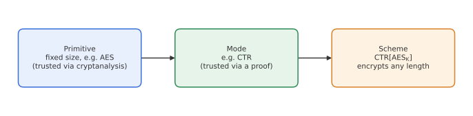
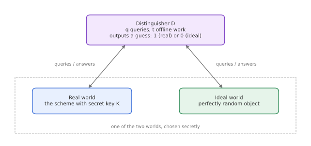
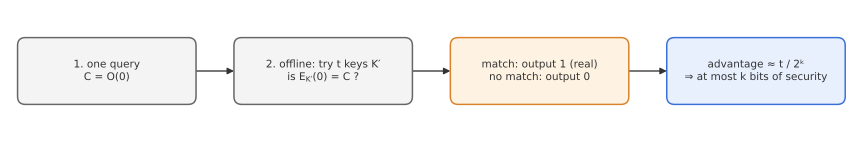

# Module 1: Foundations of Symmetric Security

*How do we say a cipher is "secure", and what does "128 bits of security" actually promise?*

Before looking at any specific algorithm, we need a language for talking about security. This module introduces that language: what symmetric cryptography is for, how security is measured, the difference between primitives and modes, and the **distinguisher game** that almost every later definition in this series is built on.

---

## 1. What symmetric cryptography is for

Symmetric cryptography assumes two parties already share a secret key $K$. With it, they want two things:

- **Confidentiality:** an eavesdropper learns nothing useful about the messages.
- **Authenticity:** a receiver can detect if a message was forged or modified.

The core functionalities that deliver these are:

| Functionality | Goal | Example |
|---|---|---|
| Encryption | confidentiality | AES-CTR, ChaCha20 |
| Message authentication (MAC) | authenticity | HMAC, Poly1305 |
| Authenticated encryption (AE) | both at once | AES-GCM, ChaCha20-Poly1305, Ascon |
| Hashing | integrity, building block | SHA-2, SHA-3 |

Hashing is unkeyed, but it shows up everywhere inside the keyed constructions, which is why it sits on this list.

---

## 2. Measuring security: "bits of security"

We say a scheme offers **$s$ bits of security** if the best attack using $2^a$ operations succeeds with probability roughly

$$
\Pr[\text{success}] \approx \frac{2^a}{2^s}.
$$

So with $s = 128$:

- an attacker doing $2^{64}$ operations succeeds with probability about $2^{-64}$, which is negligible;
- to have a real chance, the attacker needs close to $2^{128}$ operations.

This is a convenient single number, but it hides an important point: it only makes sense if we say *what* the attacker is trying to do and *what resources* they have. The rest of this module makes that precise.

### What determines the security level?

Three things, and the weakest of them wins:

1. **Key length.** A $k$-bit key can always be found by trying all $2^k$ keys, so security is at most $k$ bits.
2. **Security of the primitive.** The fixed-size building block (for example AES) must have no shortcut attacks.
3. **Security of the mode.** The construction that turns the primitive into something usable for arbitrary-length data must not introduce weaknesses of its own.

---

## 3. Primitives and modes

It helps to split a cryptographic scheme into two layers.

- A **primitive** is a fixed-size function. AES, for example, maps a 128-bit block to a 128-bit block under a key.
- A **mode** (or construction) uses the primitive to process variable-length data. Counter mode, written $\mathrm{CTR}[\mathrm{AES}_K]$, turns AES into a stream cipher that can encrypt any length.

The two layers earn our trust in very different ways:

| | Primitive | Mode |
|---|---|---|
| Why we trust it | Years of public cryptanalysis have not broken it | A mathematical **security proof** |
| Formal proof? | No | Yes, *relative to* the primitive |

There are two common styles of proof for modes:

1. **Reductionist proof:** "If you can break the mode, you can break the primitive (or a hard problem)." Security of the mode is reduced to security of something we already trust.
2. **Ideal-model proof:** "If the primitive were perfect (an ideal random function or permutation), the mode would be secure." Here the primitive is replaced by an idealised object and only the mode's structure is analysed.

> **Kerckhoffs's principle.** Security must rely only on the secrecy of the key $K$, never on keeping the algorithm secret. Everything in this series assumes the attacker knows exactly how the scheme works.

---

## 4. The distinguisher game

Almost every security definition in symmetric cryptography follows the same template. An adversary, called a **distinguisher** $\mathcal{D}$, is placed in front of one of two worlds without being told which:

- the **real world**: the actual keyed scheme with a secret random key;
- the **ideal world**: a perfectly random object with the same interface.

$\mathcal{D}$ can send queries and see the answers. At the end it outputs a guess, $1$ or $0$, for which world it thinks it was in.

The **advantage** of $\mathcal{D}$ measures how much better than a coin flip it does:

$$
\Delta_{\mathcal{D}}(\text{real} \,;\, \text{ideal}) = \Big|\Pr[\mathcal{D}^{\text{real}} = 1] - \Pr[\mathcal{D}^{\text{ideal}} = 1]\Big|.
$$

- Advantage $0$: $\mathcal{D}$ cannot tell the worlds apart at all.
- Advantage close to $1$: $\mathcal{D}$ reliably tells them apart, so the scheme is broken.

The intuition: if no realistic adversary can tell the scheme from an ideal random object, then any attack that would work on the scheme would also have to work on a perfectly random object, which is impossible.

### Resources: $q$ and $t$

We usually care about the best possible distinguisher with given resources:

- **Data complexity $q$**: the number (or total size) of queries to the keyed system. These are "online" and often limited in practice, since each one requires interaction with the real key holder.
- **Time complexity $t$**: everything $\mathcal{D}$ does on its own, offline, such as trying candidate keys.

We write $\mathrm{Adv}(q, t)$ for the maximum advantage over all distinguishers using at most $q$ queries and $t$ time. A bound on this quantity is used in two ways: as a **security claim** for a concrete design like AES, and as a **proven bound** for a mode, assuming its building block meets its own claim.

---

## 5. PRF security: stream ciphers as the example

A **stream cipher** takes a key $K$, a **diversifier** $D$ (a nonce) and a length $\ell$, and outputs a keystream $Z = z_1 z_2 \dots z_\ell$. Encryption is simply

$$
C = M \oplus Z, \qquad Z = \mathrm{SC}_K(D, |M|).
$$

The diversifier **must be unique** for each message. Reusing it gives the same keystream twice, and then $C \oplus C' = M \oplus M'$ leaks the XOR of two plaintexts.

*Example.* Pay-TV and mobile telephony split data into short, numbered frames. The frame number is a natural diversifier: each frame gets fresh keystream without any extra coordination.

What should a good stream cipher look like? Its output should be indistinguishable from fresh random bits for every new diversifier. So we compare it to a **random oracle** $\mathsf{RO}$, which returns independent uniformly random bits for each new input:

$$
\mathrm{Adv}^{\mathrm{prf}}_{\mathrm{SC}}(\mathcal{D}) = \Big|\Pr[\mathcal{D}^{\mathrm{SC}_K} = 1] - \Pr[\mathcal{D}^{\mathsf{RO}} = 1]\Big|.
$$

This is **PRF security** (pseudorandom function). It applies to functions with arbitrary-length inputs and outputs, which makes it the natural target for stream ciphers, MACs and keystream generators.

---

## 6. PRP and SPRP security: block ciphers

A **block cipher** $E_K$ maps an $n$-bit block to an $n$-bit block, and for each key it is a **bijection**: every input has exactly one output and the inverse $E_K^{-1}$ exists.

Since it is a permutation, the right ideal object is not a random function but a **random permutation** $p$. This gives **PRP security**:

$$
\mathrm{Adv}^{\mathrm{prp}}_{E}(\mathcal{D}) = \Big|\Pr[\mathcal{D}^{E_K} = 1] - \Pr[\mathcal{D}^{p} = 1]\Big|.
$$

If the distinguisher may also query the inverse direction, we get the stronger **SPRP** (strong PRP) notion:

$$
\mathrm{Adv}^{\mathrm{sprp}}_{E}(\mathcal{D}) = \Big|\Pr[\mathcal{D}^{E_K,\,E_K^{-1}} = 1] - \Pr[\mathcal{D}^{p,\,p^{-1}} = 1]\Big|.
$$

SPRP matters whenever an attacker can get decryptions of chosen ciphertexts, which is a realistic threat in many protocols.

| Notion | Real world | Ideal world | Typical use |
|---|---|---|---|
| PRF | keyed function | random oracle | stream ciphers, MACs |
| PRP | $E_K$ | random permutation $p$ | block ciphers, forward only |
| SPRP | $E_K, E_K^{-1}$ | $p, p^{-1}$ | block ciphers, both directions |

### Connecting the layers: CTR mode

CTR mode encrypts by computing $Z = E_K(N\Vert 1) \Vert E_K(N\Vert 2) \Vert \dots$, so it uses a block cipher to build a PRF-style keystream. A reductionist proof gives

$$
\mathrm{Adv}^{\mathrm{prf}}_{\mathrm{CTR}[E]}(q, t) \;\le\; \mathrm{Adv}^{\mathrm{prp}}_{E}(q, t) + \frac{q^2}{2^{n+1}},
$$

where $q$ is the total number of blocks queried.

Reading this bound term by term:

- **First term:** if AES is a good PRP, this is tiny.
- **Second term:** the price of using a permutation where a function is wanted. A random permutation *never* repeats an output, while a random function would start to repeat after about $2^{n/2}$ outputs (the birthday bound). An attacker who sees many blocks can notice this absence of collisions. For AES with $n = 128$, this term stays small as long as you encrypt well below $2^{64}$ blocks under one key.

---

## 7. Key recovery seen as a distinguisher

The most obvious attack, exhaustive key search, fits neatly into the distinguisher framework. Suppose $\mathcal{D}$ has access to either $(E_K, E_K^{-1})$ or $(p, p^{-1})$:

1. Make **one** query: $C = \mathcal{O}(0)$.
2. Offline, try $t$ candidate keys $K'$, checking whether $E_{K'}(0) = C$.
3. If some key matches, output $1$ ("real world"), otherwise $0$.

In the real world, $\mathcal{D}$ succeeds when the true key is among its $t$ guesses, which happens with probability about $t/2^k$. In the ideal world, a match only happens by accident, which is negligible for typical parameters. So

$$
\mathrm{Adv}^{\mathrm{sprp}}_{E}(\mathcal{D}) \approx \frac{t}{2^k}
\qquad\Longrightarrow\qquad
\mathrm{Adv}^{\mathrm{sprp}}_{E}(q, t) \gtrsim \frac{t}{2^k}.
$$

This is a **lower bound** on the advantage that holds for every block cipher. The conclusion: a block cipher with a $k$-bit key offers **at most $k$ bits of security**, no matter how well it is designed. That is the formal version of "key length caps security" from Section 2.

---

## Key takeaways

- Security levels are stated as "an attack with $2^a$ effort succeeds with probability about $2^a / 2^s$."
- Primitives are trusted through cryptanalysis; modes are trusted through proofs relative to the primitive.
- Most definitions are **distinguisher games**: real scheme vs ideal random object, measured by advantage.
- **PRF** compares to a random function, **PRP** to a random permutation, **SPRP** adds inverse queries.
- Using a permutation as if it were a function costs a **birthday-bound** term, roughly $q^2 / 2^{n}$.
- Exhaustive search shows every $k$-bit-key cipher has at most **$k$ bits** of security.

**Next:** [Module 2: Stream Ciphers, Block Ciphers and AES](02-block-ciphers-aes.md)
