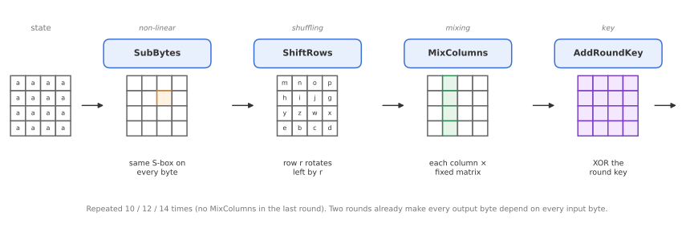
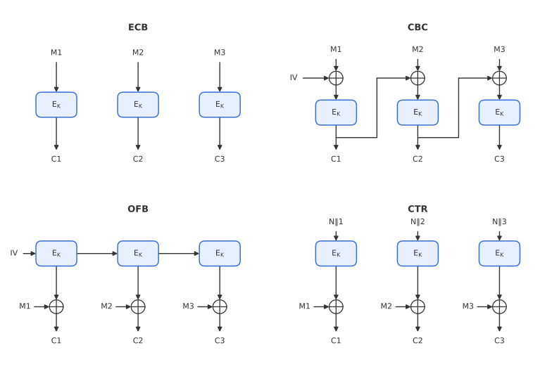

# Module 2: Stream Ciphers, Block Ciphers and AES

*What actually happens inside AES, and why does the mode you wrap it in matter just as much?*

Module 1 gave us the language: a block cipher should behave like a random permutation (PRP), and a stream cipher like a random function (PRF). This module looks at the most important block cipher in use today, AES, and at the classic **modes of operation** that turn a 128-bit block cipher into something that can encrypt a file, a disk or a network packet.

---

## 1. AES at a glance

AES (the Advanced Encryption Standard) is the Rijndael block cipher, selected by NIST in 2000 after an open public competition.

| Property | AES |
|---|---|
| Block size | 128 bits (a $4 \times 4$ array of bytes, called the **state**) |
| Key sizes | 128, 192 or 256 bits |
| Rounds | 10, 12 or 14 respectively |
| Works on | bytes, not individual bits |

> **Rijndael vs AES.** The original Rijndael design supports block and key lengths of 128, 160, 192, 224 and 256 bits. The AES standard fixes the block length at 128 bits and allows only the three key lengths above.

A block cipher like AES has two parts:

1. **The round function**, applied repeatedly to the state.
2. **The key schedule**, which expands the cipher key into one **round key** per round. It is a recursive procedure that can be computed in place.

All rounds are identical, except that each one uses a different round key, and the last round omits the mixing layer. The design is also *parallel and symmetric*: every byte, row and column is treated the same way, which makes AES fast in both hardware and software.

---

## 2. The AES round function

Each round applies four layers. Every layer has a specific job, and the security comes from how they combine.

### SubBytes: the non-linear layer

Every byte of the state is replaced using the same fixed, invertible lookup table, the **S-box**.

$$
b_{i,j} = S(a_{i,j})
$$

This is the only non-linear step in AES. Without it, the whole cipher would be a system of linear equations that an attacker could solve directly. The S-box was chosen to resist the classic attacks: **differential cryptanalysis** (DC), **linear cryptanalysis** (LC) and algebraic attacks, *when combined with the other layers*.

### ShiftRows: the shuffling layer

Row $r$ of the state is rotated left by $r$ positions (row 0 stays put, row 1 shifts by one byte, and so on). The effect is that the four bytes of one column end up in four different columns.

On its own this does nothing cryptographically interesting, but combined with MixColumns it spreads changes across the whole state very quickly.

### MixColumns: the mixing layer

Each column is treated as a vector of four bytes and multiplied by a fixed $4 \times 4$ circulant matrix over the finite field $\mathrm{GF}(2^8)$:

$$
\begin{pmatrix} b_0 \\ b_1 \\ b_2 \\ b_3 \end{pmatrix}
=
\begin{pmatrix} 2 & 3 & 1 & 1 \\ 1 & 2 & 3 & 1 \\ 1 & 1 & 2 & 3 \\ 3 & 1 & 1 & 2 \end{pmatrix}
\begin{pmatrix} a_0 \\ a_1 \\ a_2 \\ a_3 \end{pmatrix}
$$

The matrix is chosen so that a change in input bytes propagates to many output bytes:

| Input bytes changed | Output bytes changed (at least) |
|---|---|
| 1 | 4 |
| 2 | 3 |
| 3 | 2 |
| 4 | 1 |

In every row the total is at least 5. This is called the **branch number**, and 5 is the maximum possible for a $4 \times 4$ byte matrix. It guarantees that differences cannot stay small.

### AddRoundKey

The round key is XORed into the state, byte by byte. This is the only step that involves the key; everything else is public and fixed.

### Diffusion in two rounds

ShiftRows moves the bytes of one column to four columns, and MixColumns spreads each byte over a whole column. After **two rounds**, every output byte depends on every input byte. Ten rounds give a large safety margin on top of that.

---

## 3. Stream ciphers, briefly

A stream cipher generates a keystream $Z$ from a key and a nonce, and encrypts by $C = M \oplus Z$ (see Module 1). Two important points:

- Encryption and decryption are the same operation, so no inverse is needed.
- The nonce must **never** repeat under the same key, otherwise $C \oplus C' = M \oplus M'$.

You can build a stream cipher from scratch (ChaCha20, for example), or you can build one from a block cipher. Two of the modes below do exactly that.

---

## 4. Modes of operation

A block cipher only encrypts a single 128-bit block. A **mode of operation** defines how to encrypt a longer message $M = M_1 \Vert M_2 \Vert \dots \Vert M_\ell$.

### ECB: Electronic Codebook

Each block is encrypted independently:

$$
C_i = E_K(M_i)
$$

ECB is simple and fully parallel, but it is **deterministic per block**: identical plaintext blocks always produce identical ciphertext blocks. Any structure in the data (repeated headers, large areas of one colour in an image) shows up directly in the ciphertext. The well-known "ECB penguin" picture, where an encrypted image still clearly shows the outline of the original, is exactly this effect.

ECB also needs **padding** when the message is not a multiple of the block length. It should not be used to encrypt data.

### CBC: Cipher Block Chaining

Each plaintext block is XORed with the previous ciphertext block before encryption:

$$
C_0 = IV, \qquad C_i = E_K(M_i \oplus C_{i-1})
$$

- The **IV** must be random and **unpredictable** for each message. A predictable IV led to the BEAST attack on TLS 1.0.
- Encryption is **sequential**, because each block needs the previous ciphertext. Decryption, $M_i = E_K^{-1}(C_i) \oplus C_{i-1}$, can be done **in parallel**, since all ciphertext blocks are known.
- It needs the **inverse** $E_K^{-1}$ for decryption.
- It needs **padding**, so the ciphertext can be longer than the plaintext. **Ciphertext stealing** is a trick that avoids this expansion by borrowing bits from the second-to-last ciphertext block (it reappears with XTS in Module 5).
- If an IV is accidentally reused, CBC fails **gracefully**: an attacker only learns whether two messages share an identical prefix, not their contents.

### OFB: Output Feedback

The block cipher is iterated on the IV to produce a keystream:

$$
Z_0 = IV, \qquad Z_i = E_K(Z_{i-1}), \qquad C_i = M_i \oplus Z_i
$$

OFB turns AES into a **stream cipher**. It is inverse-free, needs no padding, and a bit flip in $C$ only flips the same bit in $M$. Its drawback is that keystream generation is **sequential**.

### CTR: Counter mode

The block cipher is applied to a nonce together with a counter:

$$
Z_i = E_K(N \Vert i), \qquad C_i = M_i \oplus Z_i
$$

CTR is also a stream cipher, but every keystream block can be computed independently. It is parallel in both directions, inverse-free, needs no padding, and allows random access (decrypt block 1000 without touching blocks 1 to 999). Its security is the PRF bound from Module 1, which holds up to the birthday bound of about $2^{64}$ blocks for AES.

The price is that CTR is **unforgiving of nonce reuse**: a repeated nonce gives a repeated keystream, and the XOR of the two plaintexts leaks.

### Comparison

| Property | ECB | CBC | OFB | CTR |
|---|:---:|:---:|:---:|:---:|
| Parallel encryption | ✓ | ✗ | ✗ | ✓ |
| Parallel decryption | ✓ | ✓ | ✗ | ✓ |
| Inverse-free (no $E_K^{-1}$ needed) | ✗ | ✗ | ✓ | ✓ |
| No message expansion (no padding) | ✗ | ✗ | ✓ | ✓ |
| Bit flip in $C$ only flips one bit in $M$ | ✗ | ✗ | ✓ | ✓ |
| Graceful degradation under nonce reuse | n/a | ✓ | ✗ | ✗ |

CTR wins on almost every line, which is why it is the encryption core of GCM (Module 4).

> **None of these modes provides authenticity.** Because OFB and CTR are malleable (flip a bit in $C$, and the same bit flips in $M$), an attacker can modify messages in a controlled way. Encryption alone is never enough; Modules 3 and 4 fix this.

---

## Key takeaways

- AES is a 128-bit block cipher with 10, 12 or 14 rounds of SubBytes, ShiftRows, MixColumns and AddRoundKey.
- SubBytes provides non-linearity; ShiftRows and MixColumns provide diffusion; AddRoundKey brings in the key.
- MixColumns has branch number 5, which guarantees fast spreading of differences.
- **ECB** leaks patterns and should not be used. **CBC** needs a random IV and padding. **OFB** and **CTR** turn a block cipher into a stream cipher.
- **CTR** is parallel, inverse-free and expansion-free, but catastrophic under nonce reuse.
- No mode in this module provides integrity.

**Previous:** [Module 1: Foundations of Symmetric Security](01-foundations.md) · **Next:** [Module 3: Message Authentication](03-message-authentication.md)
