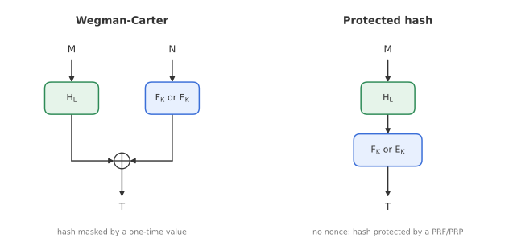

# Module 3: Message Authentication

*How can a receiver be sure a message really came from the sender, unchanged, and why is a "random-looking" function not quite the goal?*

Encryption hides data, but as Module 2 showed, it does not stop an attacker from changing it. A **message authentication code (MAC)** adds a short tag to a message so that any modification, or any message the sender never produced, is detected. This module defines what a secure MAC is, and builds MACs efficiently from **universal hash functions**: the Wegman-Carter family (including Poly1305) and the protected-hash family (including CBC-MAC).

---

## 1. MAC and verification

A MAC scheme has two algorithms that share a key $K$:

- $\mathrm{MAC}_K(M) = T$: takes a message of any length and returns a fixed-length **tag** $T$ of $t$ bits.
- $\mathrm{VFY}_K(M, T) \in \{\top, \bot\}$: returns $\top$ (accept) if $T$ is the correct tag for $M$, and $\bot$ (reject) otherwise.

Some MACs also take a **nonce** $N$ as input.

MACs are used for:

- **Message authentication:** the receiver checks that the message was produced by someone holding $K$, and was not modified.
- **Entity authentication:** in a challenge-response protocol, a party proves it knows $K$ by computing the tag on a fresh challenge.

---

## 2. Security: unforgeability

The goal of a MAC is not secrecy; it is that nobody without $K$ can produce a valid tag. The adversary $\mathcal{A}$ gets access to both oracles:

- it can ask for tags on messages of its choice ($q_m$ **MAC queries**),
- it can submit candidate pairs $(M^*, T^*)$ for verification ($q_v$ **verification queries**).

$\mathcal{A}$ **wins** if any verification query returns $\top$ for a pair it did not get from the MAC oracle. There are two restrictions:

1. Submitting a pair that the MAC oracle already returned does not count; that is a replay, not a forgery.
2. If the MAC uses a nonce, $\mathcal{A}$ may not repeat a nonce in MAC queries, but it *may* use any nonce in verification queries.

The **unforgeability advantage** is the probability that $\mathcal{A}$ wins:

$$
\mathrm{Adv}^{\mathrm{unf}}_{\mathrm{MAC}}(\mathcal{A}) = \Pr\big[\mathcal{A}^{\mathrm{MAC}_K,\,\mathrm{VFY}_K} \text{ forges}\big].
$$

### The trivial bound

There is one attack that always works: guess the tag. Each guess is right with probability $2^{-t}$, so with $q_v$ verification attempts

$$
\mathrm{Adv}^{\mathrm{unf}}_{\mathrm{MAC}}(q_m, q_v) \;\ge\; \frac{q_v}{2^t}.
$$

A good MAC is one where nothing does significantly better. This is why tags are usually at least 64, and preferably 128, bits long.

---

## 3. PRF security implies unforgeability

If a MAC behaves like a random function (it is PRF-secure, Module 1), it is automatically unforgeable:

$$
\mathrm{Adv}^{\mathrm{unf}}_{\mathrm{MAC}}(q_m, q_v) \;\le\; \mathrm{Adv}^{\mathrm{prf}}_{\mathrm{MAC}}(q_m + q_v) + \frac{q_v}{2^t}.
$$

The reasoning: replace the MAC by a random function. The tag of any new message is then uniformly random and independent of everything $\mathcal{A}$ has seen, so the best it can do is guess. The only extra cost is how well $\mathcal{A}$ can tell the real MAC from a random function, which is the PRF term.

The converse is **not** true. A MAC can be perfectly unforgeable without looking random (for example, a MAC whose tags always start with a zero bit). Unforgeability is the real goal; PRF security is a convenient, stronger property that many MACs happen to have.

---

## 4. Universal hash functions

Building a MAC directly as a PRF on long messages is expensive. The classic shortcut is to first compress the message with a much cheaper keyed function, a **universal hash**, and then apply a strong cryptographic function only once to the short result.

A universal hash $H_L$ has the same interface as a MAC (key $L$, long message in, short output), but a much weaker security goal, and its output must **never be shown to the attacker directly**. We only ask that two distinct messages rarely collide, over the random choice of $L$.

**$\delta$-universal:** for all $M \neq M'$,

$$
\Pr_L\big[H_L(M) = H_L(M')\big] \le \delta.
$$

**$\varepsilon$-XOR-universal:** for all $M \neq M'$ and every value $\Delta$,

$$
\Pr_L\big[H_L(M) \oplus H_L(M') = \Delta\big] \le \varepsilon.
$$

XOR-universality is the stronger notion: taking $\Delta = 0$ gives $\delta$-universality. A random function satisfies both with $\varepsilon = \delta = 2^{-n}$, but a universal hash is far from a random function. It can be linear and easy to invert once you know $L$; it just has to make collisions unlikely when $L$ is secret.

### Example: polynomial evaluation

The standard construction is evaluating a polynomial at a secret point $L$ in a finite field. Split $M$ into blocks $M_1, \dots, M_\ell$ and compute

$$
H_L(M) = M_1 L^{\ell} + M_2 L^{\ell-1} + \dots + M_\ell L.
$$

This can be computed block by block with **Horner's rule**: multiply the running value by $L$, add the next block, repeat. Two different messages of $\ell$ blocks collide only if $L$ is a root of their (non-zero) difference polynomial, which has at most $\ell$ roots. So

$$
\varepsilon \approx \frac{\ell}{2^n}.
$$

**GHASH**, the universal hash inside AES-GCM (Module 4), is exactly this, computed in $\mathrm{GF}(2^{128})$. **Poly1305** (below) is the same idea in the prime field modulo $2^{130} - 5$.

---

## 5. Wegman-Carter

The **Wegman-Carter** construction hides the universal hash output by XORing it with a fresh pseudorandom value derived from a nonce:

$$
T = H_L(M) \oplus F_K(N).
$$

If $H$ is $\varepsilon$-XOR-universal, $F$ is a PRF, and **nonces are never repeated** in MAC queries, then

$$
\mathrm{Adv}^{\mathrm{unf}}_{\mathrm{WC}}(q_m, q_v) \;\le\; q_v\,\varepsilon + \mathrm{Adv}^{\mathrm{prf}}_{F}(q_m + q_v).
$$

**Why it works.** Each $F_K(N)$ is a fresh one-time pad, so tags reveal nothing about $L$. To forge with a nonce $N$ already used for $(M, T)$, the adversary needs $T^* \oplus T = H_L(M^*) \oplus H_L(M)$, which by XOR-universality happens with probability at most $\varepsilon$ per attempt.

**Why the nonce matters.** If a nonce is reused for two messages, then $T \oplus T' = H_L(M) \oplus H_L(M')$. The mask cancels, and for polynomial hashes this equation can often be solved for $L$. Once $L$ is known, the attacker can forge tags for that nonce at will.

### Wegman-Carter-Shoup (WCS)

True PRFs on 128-bit inputs are awkward to build, but block ciphers are everywhere. **WCS** replaces $F_K$ with a block cipher $E_K$:

$$
T = H_L(M) \oplus E_K(N).
$$

Because a permutation never repeats an output, the masks are slightly *less* random than a PRF's, and the bound picks up a factor that depends on $q_m$:

$$
\mathrm{Adv}^{\mathrm{unf}}_{\mathrm{WCS}}(q_m, q_v) \;\lesssim\; e^{\frac{(q_m+1)\,q_m}{2^{n}}}\; q_v\,\varepsilon \;+\; \mathrm{Adv}^{\mathrm{prp}}_{E}(q_m + q_v).
$$

For $q_m$ well below $2^{n/2}$, the exponential factor is essentially 1 and WCS is as good as Wegman-Carter. Beyond the birthday bound the guarantee degrades, but gracefully: there is no sudden break. This is the construction behind GCM's authentication tag.

---

## 6. Poly1305

**Poly1305** (Bernstein, 2005) is a widely used Wegman-Carter-style MAC. In its original form, Poly1305-AES, it uses two 128-bit keys: $r$ for the polynomial and $k$ for AES, plus a 128-bit nonce $N$.

1. Split the message into 16-byte chunks.
2. Append a byte `0x01` to each chunk and read it as a little-endian integer $c_i$. For a full 16-byte chunk this gives a number in $[2^{128}, 2^{129})$. The extra 1 ensures that trailing zero bytes still change the result, so $M$ and $M \Vert 0$ do not collide.
3. Evaluate the polynomial modulo the prime $p = 2^{130} - 5$:

$$
h = \big(c_1 r^{q} + c_2 r^{q-1} + \dots + c_q r\big) \bmod (2^{130} - 5).
$$

4. Add the mask and keep 128 bits:

$$
T = \big(h + \mathrm{AES}_k(N)\big) \bmod 2^{128}.
$$

Two design details:

- **Clamping $r$.** 22 specific bits of $r$ are forced to zero. This is mainly for speed: it lets implementations split $r$ into limbs and multiply without carries overflowing. It costs a tiny amount of security, which is accounted for in the bound.
- **The prime $2^{130} - 5$.** Being just below a power of two makes reduction cheap: $2^{130} \equiv 5$, so the high bits can be folded back with a multiplication by 5.

In **ChaCha20-Poly1305** (used in TLS 1.3 and WireGuard), the AES step is replaced: ChaCha20 generates a fresh one-time key $(r, s)$ for every message from the key and nonce, and the tag is $(h + s) \bmod 2^{128}$.

---

## 7. Protected hash

The second family skips the nonce and instead puts the strong function *after* the hash:

$$
T = F_K\big(H_L(M)\big) \quad\text{or}\quad T = E_K\big(H_L(M)\big).
$$

Since the final function hides everything, $H$ only needs to be $\delta$-universal. The bound is

$$
\mathrm{Adv}^{\mathrm{unf}}_{\mathrm{PH}}(q_m, q_v) \;\le\; \binom{q_m + q_v}{2}\,\delta + \frac{q_v}{2^t} + \mathrm{Adv}^{\mathrm{prf}}_{F}(q_m + q_v).
$$

The first term is the chance that *any* two of the queried messages collide in $H$; that is a birthday-style term, so protected-hash MACs are secure only up to about $2^{n/2}$ queries. In exchange, they need **no nonce**, which makes them deterministic and robust against nonce misuse.

| | Wegman-Carter(-Shoup) | Protected hash |
|---|---|---|
| Tag | $H_L(M) \oplus F_K(N)$ | $F_K(H_L(M))$ |
| Needs a nonce | yes, must be unique | no |
| Hash requirement | $\varepsilon$-XOR-universal | $\delta$-universal |
| Nonce reuse | can leak $L$, breaks the MAC | not applicable |
| Bound | $\approx q_v\,\varepsilon$ | $\approx (q_m + q_v)^2\,\delta / 2$ |
| Examples | GMAC, Poly1305 | CBC-MAC variants, PMAC |

> **Protected hash vs. a cryptographic hash.** The universal hash here is keyed, cheap and *not* collision-resistant in the usual sense; anyone who knows $L$ can find collisions. This is different from a cryptographic hash like SHA-256 (Module 6), which is unkeyed and must resist collisions on its own.

---

## 8. CBC-MAC and the length-extension attack

**CBC-MAC** runs CBC encryption with a zero IV and outputs only the last ciphertext block:

$$
S_0 = 0, \qquad S_i = E_K(M_i \oplus S_{i-1}), \qquad T = S_\ell.
$$

It is a protected hash in disguise: the first $\ell - 1$ block-cipher calls act as the "hash", and the last call protects it. CBC-MAC is secure **only for messages of one fixed length**. With variable-length messages, it is trivially forgeable.

**The attack.**

1. Ask for the tag of a one-block message $M_1$. You get $T = E_K(M_1)$.
2. Submit the two-block message $M_1 \Vert (M_1 \oplus T)$ with tag $T$.

Verification computes

$$
E_K\big(E_K(M_1) \oplus M_1 \oplus T\big) = E_K(T \oplus M_1 \oplus T) = E_K(M_1) = T.
$$

The forgery is accepted, after a single MAC query and with probability 1.

**The fix.** Process the last block differently, so a valid tag can no longer act as an intermediate chaining value:

- **EMAC / ECBC-MAC:** encrypt the CBC-MAC output once more under an independent key, $T = E_{K'}(S_\ell)$.
- **CMAC** (NIST SP 800-38B): XOR a key-derived mask into the last block, choosing one of two masks depending on whether padding was needed. It needs only one key and no extra block-cipher call.

Both are PRF-secure up to the birthday bound.

---

## Key takeaways

- A MAC is **unforgeable** if no adversary can produce a valid new (message, tag) pair; the floor is $q_v / 2^t$ from guessing.
- PRF security implies unforgeability, but not the other way round.
- **Universal hashes** are cheap keyed functions with a collision guarantee; polynomial evaluation (GHASH, Poly1305) is the standard example.
- **Wegman-Carter:** $T = H_L(M) \oplus F_K(N)$. Strong and efficient, but a repeated nonce can leak the hash key.
- **Protected hash:** $T = F_K(H_L(M))$. No nonce needed, birthday-bound secure.
- Plain **CBC-MAC** is forgeable for variable-length messages; use CMAC or EMAC.

**Previous:** [Module 2: Stream Ciphers, Block Ciphers and AES](02-block-ciphers-aes.md) · **Next:** [Module 4: Authenticated Encryption](04-authenticated-encryption.md)
