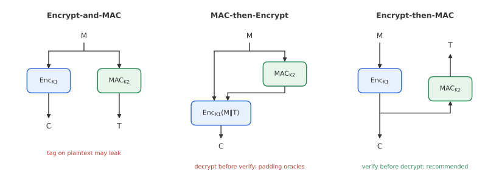
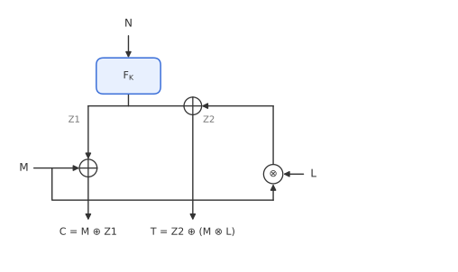
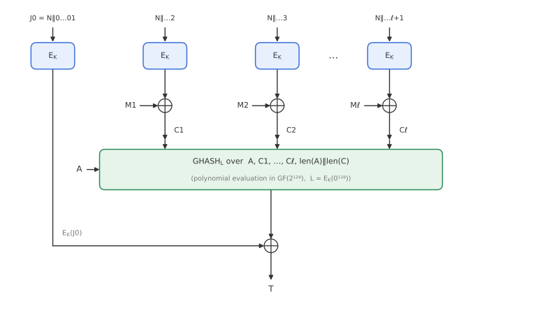
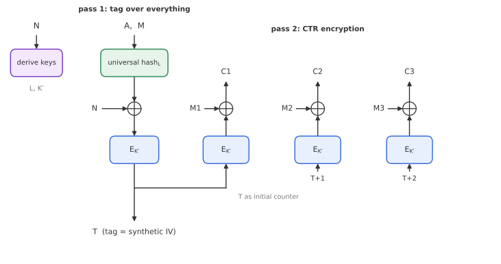

# Module 4: Authenticated Encryption

*How do we get confidentiality and authenticity at the same time, and why is reusing a nonce in AES-GCM so dangerous?*

Encryption alone gives confidentiality but no authenticity (Module 2). A MAC gives authenticity but no confidentiality (Module 3). **Authenticated encryption (AE)** delivers both in one primitive. It is what almost every modern protocol uses: TLS 1.3 only allows AE ciphers (AES-GCM, ChaCha20-Poly1305, AES-CCM). This module defines AE security, compares the three ways of combining a cipher and a MAC, builds a toy AE scheme to see exactly where nonces matter, and then looks at GCM and its nonce-misuse-resistant variant GCM-SIV.

---

## 1. The AE interface

**Encryption** takes a key $K$, a nonce $N$, **associated data** $A$ and a message $M$:

$$
\mathrm{AE}_K(N, A, M) = (C, T).
$$

**Decryption** takes the same key, nonce and associated data, plus the ciphertext and tag:

$$
\mathrm{AE}^{-1}_K(N, A, C, T) =
\begin{cases} M & \text{if the tag is valid,} \\ \bot & \text{otherwise.} \end{cases}
$$

- **Associated data** $A$ is authenticated but **not encrypted**: think of packet headers, sequence numbers or routing information that must be readable in transit but must not be tampered with.
- The **nonce** must be unique per encryption under a given key. Encrypting the same $(A, M)$ with different nonces gives unrelated outputs.
- $K$, $N$ and $T$ have fixed lengths; $A$, $M$ and $C$ can be any length, and usually $|C| = |M|$.
- The sender transmits $(N, A, C, T)$.
- Decryption must release **nothing** about the plaintext unless the tag verifies. In practice this means checking the tag before outputting any decrypted data.

---

## 2. Security model

The distinguisher $\mathcal{D}$ gets access to an encryption oracle and a decryption oracle, and must tell apart:

- **Real world:** $(\mathrm{AE}_K, \mathrm{AE}^{-1}_K)$ with a secret key.
- **Ideal world:** $(\mathsf{Rand}, \bot)$, where $\mathsf{Rand}$ returns fresh random bits of the right length for every encryption query, and $\bot$ rejects every decryption query.

$$
\mathrm{Adv}^{\mathrm{ae}}_{\mathrm{AE}}(\mathcal{D}) = \Big|\Pr\big[\mathcal{D}^{\mathrm{AE}_K,\,\mathrm{AE}^{-1}_K} = 1\big] - \Pr\big[\mathcal{D}^{\mathsf{Rand},\,\bot} = 1\big]\Big|.
$$

This single definition captures both goals:

- **Confidentiality:** encryptions must look like random strings.
- **Authenticity:** every decryption query the adversary invents must fail, because in the ideal world it always does. A single successful forgery tells the worlds apart.

The rules: nonces must not repeat across **encryption** queries, but may repeat in **decryption** queries, and $\mathcal{D}$ may not send an encryption output straight to the decryption oracle. We write $\mathrm{Adv}^{\mathrm{ae}}(q_e, q_v)$ for the best advantage with $q_e$ encryption and $q_v$ decryption queries.

---

## 3. Generic composition

The obvious way to build AE is to combine an encryption scheme with a MAC, using independent keys. There are three ways to do it.

**Encrypt-and-MAC (E&M):** encrypt $M$, and separately compute the tag on $M$.

$$
C = \mathrm{Enc}_{K_1}(M), \qquad T = \mathrm{MAC}_{K_2}(M).
$$

Not secure in general. A MAC is only required to be unforgeable, not to hide its input, so $T$ may leak information about $M$. A deterministic MAC at least leaks whether two messages are equal. (Used in SSH, with care.)

**MAC-then-Encrypt (MtE):** compute the tag on $M$, then encrypt both.

$$
C = \mathrm{Enc}_{K_1}\big(M \Vert \mathrm{MAC}_{K_2}(M)\big).
$$

Can be secure, but it is fragile. The receiver must decrypt *before* it can verify, so it processes unauthenticated ciphertext. With CBC and padding, the receiver's behaviour (a padding error versus a MAC error, or even a timing difference) becomes a **padding oracle** that can decrypt the message byte by byte. This is the root of the Lucky Thirteen and POODLE attacks on older TLS.

**Encrypt-then-MAC (EtM):** encrypt $M$, then compute the tag on the ciphertext.

$$
C = \mathrm{Enc}_{K_1}(M), \qquad T = \mathrm{MAC}_{K_2}(N, A, C).
$$

The recommended option. If the encryption is secure and the MAC is unforgeable, EtM is a secure AE scheme. The receiver verifies $T$ first and discards any modified ciphertext without decrypting it (this property is called **ciphertext integrity**). IPsec ESP uses this approach.

| | E&M | MtE | EtM |
|---|---|---|---|
| Generically secure | ✗ | sometimes | ✓ |
| Verifies before decrypting | ✗ | ✗ | ✓ |
| Known pitfalls | tag leaks about $M$ | padding oracles | none generic |

---

## 4. Designing AE from scratch: a toy example

To understand what each component of a real AE scheme does, consider a deliberately simple scheme for **fixed-length** messages of $n$ bits, without associated data.

**Ingredients:** a PRF $F_K$ that turns an $n$-bit nonce into $2n$ bits, and a secret field element $L$.

**Encryption:**

$$
Z_1 \Vert Z_2 = F_K(N), \qquad C = M \oplus Z_1, \qquad T = Z_2 \oplus (M \otimes L),
$$

where $\otimes$ is multiplication in $\mathrm{GF}(2^n)$.

**Decryption:** recompute $Z_1 \Vert Z_2 = F_K(N)$, recover $M = C \oplus Z_1$, keep it in secure memory, recompute $T^* = Z_2 \oplus (M \otimes L)$, and release $M$ only if $T^* = T$.

**Why each part is needed:**

- If $T = Z_2 \oplus M$, the tag is just a second encryption of $M$; flipping the same bits in $C$ and $T$ gives a valid forgery.
- If $T = M \otimes L$, the tag does not depend on the nonce; one known (message, tag) pair reveals $L$.
- $T = Z_2 \oplus (M \otimes L)$ is a Wegman-Carter tag (Module 3): $M \mapsto M \otimes L$ is an XOR-universal hash, masked by fresh randomness $Z_2$.

### Confidentiality

As long as nonces are unique and $F$ is a good PRF, $Z_1$ and $Z_2$ are fresh random strings for every query, so $C$ and $T$ are uniformly random, exactly as in the ideal world.

### Authenticity

Consider a forgery attempt $(N, C, T)$.

- **Fresh nonce:** $Z_2$ is unknown and random, so the correct tag is random. Success probability $2^{-n}$.
- **Nonce from an earlier query** $(N, M', C', T')$: both share the same $Z_1, Z_2$. The receiver computes $M = C \oplus Z_1 = C \oplus C' \oplus M'$, and the forgery succeeds if

$$
T = T' \oplus \big((M \oplus M') \otimes L\big) = T' \oplus \big((C \oplus C') \otimes L\big).
$$

The adversary knows $T$, $T'$, $C$ and $C'$, but not $L$, so this holds for exactly one value of $L$. Success probability again $2^{-n}$.

### Nonce reuse breaks everything

Now let the sender (wrongly) encrypt two messages $M, M'$ under the **same** nonce:

- The keystream repeats, so $C \oplus C' = M \oplus M'$, and confidentiality is lost.
- Worse, $T \oplus T' = (M \oplus M') \otimes L$. Everything except $L$ is known, so the attacker **solves for $L$** with one division in $\mathrm{GF}(2^n)$. From then on, it can forge tags for that nonce at will.

### Variable-length messages

Real messages have arbitrary length, and there may be associated data. The fix is to replace $M \otimes L$ with a universal hash over everything that must be authenticated, $H_L(A, C)$, which is exactly the polynomial hash from Module 3. Generating $Z_1$ with a stream cipher such as CTR mode gives a keystream as long as the message. The result is GCM.

---

## 5. AES-GCM

**GCM (Galois/Counter Mode)**, standardised by NIST in 2007, follows the toy design almost exactly. It uses AES and a single key $K$.

1. **Hash key:** $L = E_K(0^{128})$.
2. **Counter blocks:** with a 96-bit nonce, $J_0 = N \Vert 0^{31} \Vert 1$, and $J_i = N \Vert \langle i+1 \rangle_{32}$.
3. **Encryption (CTR mode):** $C_i = M_i \oplus E_K(J_i)$ for $i = 1, 2, \dots$
4. **Tag (Wegman-Carter-Shoup):**

$$
T = \mathrm{GHASH}_L(A, C) \oplus E_K(J_0).
$$

GHASH evaluates the polynomial hash over the blocks of $A$, then $C$, then a final block encoding $|A|$ and $|C|$.

So GCM is **Encrypt-then-MAC**, where the "MAC" is WCS and the masking value $E_K(J_0)$ plays the role of $Z_2$. A single AES key generates the encryption keystream, the tag mask and the hash key.

**Why GCM is so popular:**

- fully parallelisable (CTR and polynomial evaluation both are);
- very fast in hardware and on CPUs with AES and carry-less multiplication instructions;
- only needs AES encryption, never decryption;
- patent-free.

Its equally popular sibling **ChaCha20-Poly1305** has the same structure: a stream cipher for encryption and a Wegman-Carter MAC for the tag.

> **GCM inherits the toy scheme's weakness.** A single nonce repetition reveals the XOR of two plaintexts *and* allows recovery of the hash key $L$, after which an attacker can forge messages. This is known as the "forbidden attack" (Joux, 2006), and it has been found in real TLS servers that reused nonces.

---

## 6. Keeping nonces unique

In theory, "use each nonce once" is a simple rule. In practice, it needs state, synchronisation, or randomness, and each has costs.

| Strategy | Pros | Cons |
|---|---|---|
| **Counter** | Guaranteed unique; the best option | Needs persistent state, which is hard with multiple devices, VMs that get cloned, or crashes |
| **Random** | Stateless; works in most settings | Collides by the birthday bound. With 96-bit GCM nonces, a repeat becomes likely around $2^{48}$ messages, so NIST limits random-nonce GCM to $2^{32}$ messages per key |
| **User-chosen** | Flexible | Puts security in the hands of the caller; the attacker's favourite setting |

---

## 7. Nonce-misuse resistance and GCM-SIV

What if we design a scheme that degrades gracefully when a nonce *is* repeated? The goal: with a repeated nonce, the attacker should learn only whether the *same* $(A, M)$ was encrypted twice, and nothing else.

The key idea, called **SIV** (synthetic IV), is to make the tag depend on **everything**, including the nonce, and then use that tag as the IV for encryption. Any change to $N$, $A$ or $M$ changes the tag, and therefore the entire ciphertext.

**AES-GCM-SIV** (Gueron and Lindell; RFC 8452):

1. Derive per-nonce keys $L$ and $K'$ from the master key and $N$. (Same nonce, same keys.)
2. Compute the tag as a **protected hash** over everything: hash $(A, M)$ with the universal hash under $L$, mix in $N$, and encrypt the result under $K'$ to get $T$.
3. Encrypt $M$ in CTR mode under $K'$, using $T$ as the initial counter block.

Note the order: the tag is computed over the *plaintext* first, so structurally this is **MAC-then-Encrypt**, made safe by using a deterministic protected hash and verifying before releasing output.

**The cost:**

- **Two passes** over the message: one to compute $T$, one to encrypt. Encryption cannot begin until the whole message has been read, so it is not "online".
- Somewhat lower throughput than GCM.

**The benefit:** a repeated nonce only reveals whether two encrypted messages were identical. There is no keystream reuse and no key recovery.

---

## Key takeaways

- AE encrypts and authenticates in one step; associated data is authenticated but not encrypted.
- AE security compares the scheme to $(\mathsf{Rand}, \bot)$: random ciphertexts, and every forgery rejected.
- Of the generic compositions, **Encrypt-then-MAC** is the safe default; MtE invites padding oracles; E&M can leak.
- In Wegman-Carter-style AE, a **repeated nonce** leaks plaintext XORs and lets the attacker solve for the hash key.
- **AES-GCM** = CTR encryption + GHASH-based WCS tag. Fast and parallel, but must never reuse a nonce.
- **GCM-SIV** derives the IV from the tag, so nonce reuse only leaks message equality; it needs two passes.

**Previous:** [Module 3: Message Authentication](03-message-authentication.md) · **Next:** [Module 5: Tweakable Block Ciphers](05-tweakable-block-ciphers.md)
