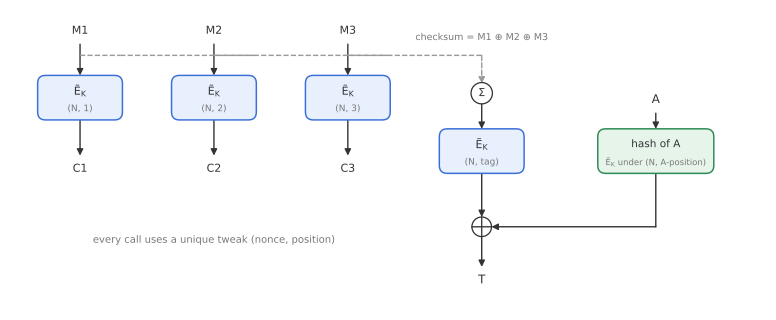
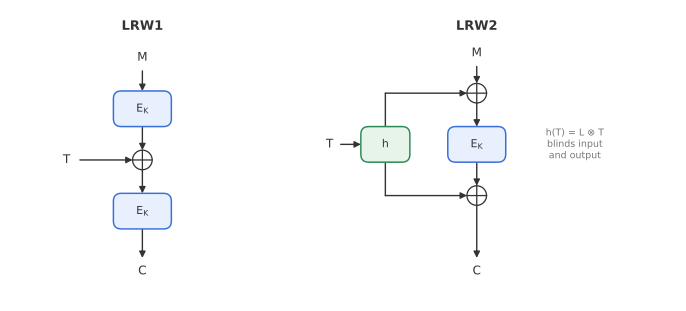
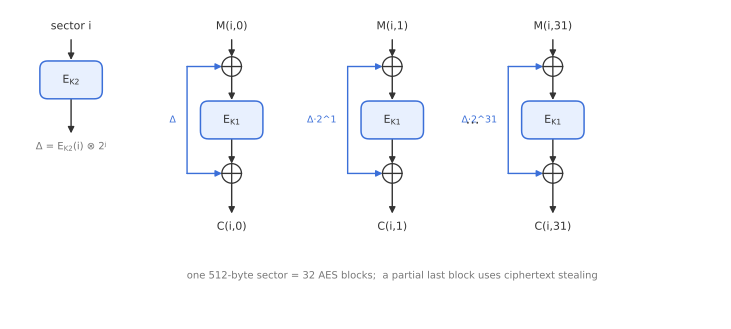

# Module 5: Tweakable Block Ciphers

*What if a block cipher took one extra public input that made every call behave like a completely different cipher?*

GCM (Module 4) builds AE from a block cipher, a stream mode and a polynomial hash. A different school of design starts from a richer primitive: the **tweakable block cipher**. With it, AE schemes like **OCB** become very simple, and the same idea gives us **XTS**, the standard mode for disk encryption. This module covers the definition, how to build tweakable block ciphers efficiently from AES using masks, and the two big applications.

---

## 1. Definition

A **tweakable block cipher (TBC)** $\widetilde{E}$ takes a key $K$, a **tweak** $T$ and an $n$-bit block $M$:

$$
C = \widetilde{E}_K(T, M), \qquad M = \widetilde{E}^{-1}_K(T, C).
$$

- For every fixed $(K, T)$, it is a permutation of $n$-bit blocks.
- The tweak is **public**, like a nonce, but unlike a nonce it **may repeat**. Repeating a tweak just means using the same permutation again.
- Different tweaks should give permutations that look **independent**, even though they all share one key.

Changing the key is usually expensive (it reruns the key schedule). Changing the tweak should be cheap. This is what makes TBCs useful: AE schemes put the nonce and the block position into the tweak, so every block of every message is processed by an effectively fresh permutation.

---

## 2. Security

A good TBC should be indistinguishable from a **random tweakable permutation** $\widetilde{p}$: a family containing an independent random permutation for each tweak.

**TPRP security:** the distinguisher may query $\widetilde{E}_K$ in the forward direction only.

$$
\mathrm{Adv}^{\mathrm{tprp}}_{\widetilde{E}}(\mathcal{D}) = \Big|\Pr\big[\mathcal{D}^{\widetilde{E}_K} = 1\big] - \Pr\big[\mathcal{D}^{\widetilde{p}} = 1\big]\Big|.
$$

**STPRP (strong) security:** the distinguisher may also query the inverse.

$$
\mathrm{Adv}^{\mathrm{stprp}}_{\widetilde{E}}(\mathcal{D}) = \Big|\Pr\big[\mathcal{D}^{\widetilde{E}_K,\,\widetilde{E}^{-1}_K} = 1\big] - \Pr\big[\mathcal{D}^{\widetilde{p},\,\widetilde{p}^{-1}} = 1\big]\Big|.
$$

These are the tweakable versions of PRP and SPRP from Module 1.

---

## 3. AE from a TBC: OCB

**OCB** (Offset Codebook, by Rogaway and others) is a fully parallel AE mode, just like GCM, but with a completely different structure. Its abstract version is often written **ΘCB**.

Every TBC call uses a tweak that consists of the **nonce** together with a **position identifier** that says which call this is: the $i$-th message block, the checksum call at the end, or the $j$-th block of associated data.

- **Encryption:** each message block is encrypted directly, $C_i = \widetilde{E}_K\big((N, i), M_i\big)$.
- **Tag:** the XOR of all message blocks (the **checksum**) is encrypted under a special tweak $(N, \text{tag})$, and XORed with a hash of the associated data, which is computed with the TBC under yet another set of tweaks.
- Padding handles a partial last block.

Since the pair (nonce, position) is unique for every call across all encryption queries, **every TBC call uses a fresh tweak**.

### Why it is secure

The analysis is a clean two-step argument, using the **triangle inequality** for advantages. First replace the real TBC with an ideal random tweakable permutation, then analyse the scheme in that ideal setting:

$$
\mathrm{Adv}^{\mathrm{ae}}_{\Theta\mathrm{CB}[\widetilde{E}]} \;\le\; \mathrm{Adv}^{\mathrm{ae}}_{\Theta\mathrm{CB}[\widetilde{p}]} + \mathrm{Adv}^{\mathrm{stprp}}_{\widetilde{E}}(q).
$$

In words: the real scheme is at most as insecure as the ideal scheme, plus the cost of how well an attacker can tell the real TBC from an ideal one.

In the ideal setting:

- **Confidentiality** is perfect. Each block is encrypted under a never-before-used random permutation, so ciphertexts are uniformly random.
- **Authenticity:** a forgery requires guessing the output of a random permutation, possibly under a tweak that was already used, which gives a slight bias:

$$
\mathrm{Adv}^{\mathrm{ae}}_{\Theta\mathrm{CB}[\widetilde{p}]}(q) \;\le\; \frac{q}{2^n - 1}.
$$

All the remaining work is in building a TBC with a good STPRP bound.

---

## 4. Building tweakable block ciphers

### Dedicated designs: the TWEAKEY framework

One approach is to design a TBC from scratch. In the **TWEAKEY** framework (Jean, Nikolić and Peyrin), the tweak and key are concatenated into a "tweakey" and processed together by a schedule that produces a round tweakey for each round, much like an AES key schedule. Deoxys-BC and SKINNY are built this way. This gives strong security, but each call costs a full cipher evaluation with tweak processing.

### Modular designs: masking a block cipher

The other approach reuses an existing block cipher such as AES and adds a cheap tweak-dependent **mask**. This is modular (the security proof only relies on AES being a good PRP) and efficient.

**LRW1 and LRW2** (Liskov, Rivest and Wagner):

$$
\mathrm{LRW1:}\quad \widetilde{E}_K(T, M) = E_K\big(T \oplus E_K(M)\big)
$$

$$
\mathrm{LRW2:}\quad \widetilde{E}_{K,h}(T, M) = E_K\big(M \oplus h(T)\big) \oplus h(T)
$$

In LRW2, $h$ is a secret XOR-universal hash, for instance $h(T) = L \otimes T$. The mask $h(T)$ "blinds" both the input and the output, so different tweaks give unrelated permutations. LRW2 is STPRP-secure up to the **birthday bound**, about $2^{n/2}$ queries. Its downside is a full field multiplication for every new tweak.

### XEX: powering-up masks

**XEX** (Rogaway) makes the mask nearly free to update. Using a block cipher $E_K$ and a nonce $N$:

$$
L = E_K(N), \qquad \Delta = 2^{\alpha}\, 3^{\beta}\, 7^{\gamma} \cdot L,
$$

$$
\widetilde{E}_K\big((N, \alpha, \beta, \gamma), M\big) = E_K(M \oplus \Delta) \oplus \Delta,
$$

where multiplication is in $\mathrm{GF}(2^n)$. The three counters encode the position:

- $\alpha \in \{1, 2, \dots\}$ counts the block index;
- $\beta, \gamma \in \{0, 1, 2\}$ distinguish the different roles (message block, checksum, associated data, final partial block).

Why these numbers? **Multiplication by 2** in $\mathrm{GF}(2^n)$ is a one-bit shift followed by a conditional XOR with a constant, so moving from block $i$ to block $i+1$ costs only a few instructions. Multiplication by 3 is $x \oplus 2x$, and by 7 is $x \oplus 2x \oplus 4x$, which are also cheap. And for the tweak sets used in practice, all the values $2^\alpha 3^\beta 7^\gamma$ are **distinct**, so every position gets a unique mask.

A variant called **XE** only masks the input, $E_K(M \oplus \Delta)$. That is enough when the inverse is never queried, for example in tag computation.

XEX is STPRP-secure up to about $2^{n/2}$ queries. It is used in OCB2 and in many CAESAR competition candidates. Permutation-based versions (with a public permutation instead of a block cipher) appear in designs like Minalpher and Prøst.

> **Why not $\Delta = L$ itself?** The tweak $(\alpha, \beta, \gamma) = (0, 0, 0)$ must be excluded. With $\Delta = L = E_K(N)$, a decryption query for $C = 0$ under nonce $N$ returns $E_K^{-1}(L) \oplus L = N \oplus L$. Since $N$ is public, this reveals the secret mask $L$. All positions must use a mask that is a *non-trivial* multiple of $L$, and the triples must be unique; any collision of masks breaks the scheme.

> **A cautionary tale.** OCB2 combined XEX and XE calls in a way that turned out to be exploitable: in 2018, Inoue and Minematsu found practical forgeries, and it was withdrawn from ISO/IEC 19772. OCB1 and OCB3 are not affected. Small details of mask choice matter.

### Gray codes and LFSRs

There are cheaper ways to step from one mask to the next:

- **Gray codes** (OCB1, OCB3): consecutive masks differ by XORing in one precomputed value, $\Delta_i = \Delta_{i-1} \oplus L_{\mathrm{ntz}(i)}$, where $\mathrm{ntz}(i)$ is the number of trailing zero bits of $i$. That is one XOR per block, with a small table of precomputed $L_j$.
- **LFSR-based masking** (MEM, Masked Even-Mansour, by Granger, Jovanovic, Mennink and Neves): the mask is updated by a word-level linear feedback shift register, which is constant-time and fast on most platforms. **OPP** (Offset Public Permutation) is an OCB-like AE scheme built from MEM and a public permutation.

| Masking | Update cost | Used in |
|---|---|---|
| Field multiplication (LRW2) | full multiplication | theory, early designs |
| Powering-up ($2^\alpha 3^\beta 7^\gamma$) | shift + conditional XOR | XEX, OCB2, XTS |
| Gray code | one XOR with a table entry | OCB1, OCB3 |
| LFSR | a few word operations, constant time | MEM, OPP |

---

## 5. XTS: disk encryption

Disk encryption has unusual requirements:

- **No ciphertext expansion:** a 512-byte sector must encrypt to exactly 512 bytes; there is no space for a nonce or tag.
- **Random access:** any sector can be read or written independently.
- **Incrementality:** changing one sector must not require re-encrypting anything else.

With no room for a nonce, encryption must be **deterministic**, so the best we can ask is that every *position* on the disk behaves like an independent random permutation. That is exactly what a TBC with the position as tweak provides.

**XTS** (XEX-based Tweaked-codebook mode with ciphertext Stealing; IEEE 1619, NIST SP 800-38E) is ECB mode with XEX as the primitive. For sector number $i$ and block number $j$ within that sector:

$$
\Delta_{i,j} = E_{K_2}(i) \otimes 2^{j}, \qquad C_{i,j} = E_{K_1}\big(M_{i,j} \oplus \Delta_{i,j}\big) \oplus \Delta_{i,j}.
$$

A 512-byte sector contains 32 AES blocks. Changing the tweak from one block to the next is a cheap multiplication by 2.

**Ciphertext stealing** handles data whose length is not a multiple of 16 bytes, without expanding it. If the last block $M_d$ is short, it is padded with the tail end of the *previous* ciphertext block $C_{d-1}$, which is then encrypted; the truncated $C'_{d-1}$ is stored in its place. The output has exactly the same length as the input.

**What XTS does and does not protect against:**

- Identical data in different positions encrypts differently, unlike plain ECB.
- But the same data written to the same position twice encrypts identically. An attacker who sees snapshots of the disk at two moments learns which blocks changed.
- There is **no authentication**. An attacker can replace a block with an earlier version of it, or randomise it, and the change will not be detected (although it decrypts to garbage, not to a chosen value).

These are accepted trade-offs for full-disk encryption. XTS is used in BitLocker, FileVault 2, LUKS and VeraCrypt (see Module 7).

---

## Key takeaways

- A **tweakable block cipher** adds a public tweak; each tweak should select an independent-looking permutation, and changing the tweak should be cheap.
- **OCB/ΘCB** puts (nonce, position) into the tweak, giving perfect confidentiality and $q/(2^n-1)$ forgery probability in the ideal setting, plus the STPRP advantage of the TBC.
- Tweakable block ciphers can be built from scratch (TWEAKEY) or by **masking** a block cipher: LRW2, XEX, Gray codes, LFSRs.
- Masks must be **non-trivial and unique** per position; mistakes here have broken real schemes (OCB2).
- **XTS** is ECB over XEX with ciphertext stealing: deterministic, length-preserving and unauthenticated, designed for disks.

**Previous:** [Module 4: Authenticated Encryption](04-authenticated-encryption.md) · **Next:** [Module 6: Hash Functions](06-hash-functions.md)
