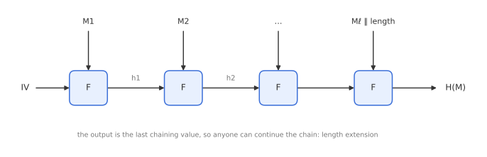
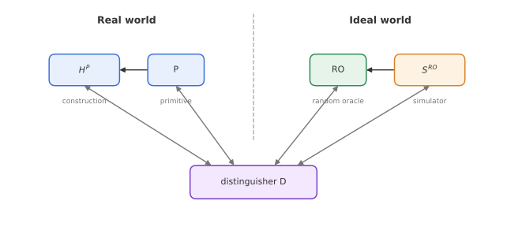
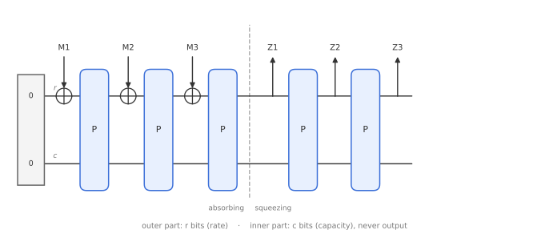

# Module 6: Hash Functions

*How can a public function with no key at all be "secure", and why did SHA-3 abandon the design behind MD5, SHA-1 and SHA-2?*

A hash function compresses an arbitrary message into a short, fixed-size digest. It has no key, yet it sits underneath signatures, password storage, key derivation, commitments and post-quantum signatures. This module covers what we want from a hash function, the classic **Merkle-Damgård** design and its length-extension problem, the more subtle notion of **indifferentiability**, and the **sponge** construction behind SHA-3.

---

## 1. What hash functions are for

A hash function $H$ takes a message of any length and outputs an $n$-bit digest. Two motivating applications show which properties we need.

**Digital signatures.** Signing a long message directly with a public-key scheme is slow, so we sign its hash: $\sigma = \mathrm{Sign}(sk, H(M))$. The receiver verifies $\sigma$ against $H(M)$. This is safe only if nobody can find a different message with the same hash:

- If an attacker can find any pair $M \neq M'$ with $H(M) = H(M')$, they can get $M$ signed and then claim the signature is for $M'$. This must be infeasible: **collision resistance**.
- If an attacker intercepts a signed $(M, \sigma)$, it suffices to find any $M' \neq M$ with $H(M') = H(M)$. Avoiding this is **second-preimage resistance**, a weaker requirement.

**Password storage.** A server stores $h = H(\text{password}, \text{salt})$ instead of the password. If the database leaks, the attacker has $h$ and the salt, and wants a password that hashes to $h$. Preventing this requires **preimage resistance** (although in practice, weak passwords make guessing much easier than inverting $H$, which is why Module 7 adds deliberate slowness).

Hash functions are also used to **destroy algebraic structure**, for example in RSA-OAEP encryption and RSA-PSS signatures (Module 11), where a hash stops the attacker from exploiting RSA's multiplicative property.

### Classical security requirements

| Property | Attacker's task | Generic cost |
|---|---|---|
| Preimage resistance | given $h$, find $M$ with $H(M) = h$ | $2^n$ |
| Second-preimage resistance | given $M$, find $M' \neq M$ with $H(M') = H(M)$ | $2^n$ |
| Collision resistance | find any $M \neq M'$ with $H(M) = H(M')$ | $2^{n/2}$ |

Collisions are cheaper because of the **birthday paradox**: after hashing about $2^{n/2}$ random messages, two of them are likely to share a digest. This is why a 256-bit hash gives 128 bits of collision resistance.

---

## 2. Merkle-Damgård

The **Merkle-Damgård** construction (independently by Merkle and Damgård, 1989) builds a hash function for arbitrary lengths from a fixed-size **compression function**

$$
F : \{0,1\}^{n} \times \{0,1\}^{m} \to \{0,1\}^{n}.
$$

1. Pad the message and split it into $m$-bit blocks $M_1, \dots, M_\ell$. The padding encodes the **message length** in the last block (this is called *MD strengthening*).
2. Start from a fixed initial value $h_0 = IV$.
3. Iterate: $h_i = F(h_{i-1}, M_i)$.
4. Output $H(M) = h_\ell$.

MD5, SHA-1 and SHA-2 all use this design. Its main selling point is a clean security proof: **if the compression function $F$ is collision-resistant, so is $H$**. Any collision in $H$ can be traced back to a collision in $F$ somewhere along the chain (the length encoding is what makes this argument work for messages of different lengths).

The compression function is typically built from a block cipher using the **Davies-Meyer** construction: $F(h, M) = E_M(h) \oplus h$, with the message block acting as the key. This is a slightly odd use of a block cipher: it compresses $n + m$ bits to $n$ bits, but is built from something that, for each key, is a bijection.

> **MD5 internals.** 128-bit digest, a state of four 32-bit words, 512-bit message blocks (16 words), and 64 steps each consuming one message word. Collisions for MD5 can now be found in seconds, and SHA-1 collisions were demonstrated publicly in 2017 (SHAttered).

### The length-extension problem

Because the output of Merkle-Damgård *is* the internal chaining value, anyone who knows $H(M)$ and $|M|$ can continue the computation:

$$
H\big(M \Vert \mathrm{pad}(M) \Vert X\big) = \text{continue from } h_\ell = H(M) \text{ with the blocks of } X.
$$

No knowledge of $M$ itself is needed. This makes the natural MAC construction $\mathrm{MAC}_K(M) = H(K \Vert M)$ **insecure** with SHA-1 or SHA-2: from a valid tag for $M$, an attacker computes a valid tag for $M \Vert \mathrm{pad} \Vert X$. HMAC (Module 7) is the standard workaround. A random oracle would not have this property, which suggests that "collision-resistant" is not the whole story.

---

## 3. Indifferentiability

In practice we often want a hash function to behave like a **random oracle** (RO): a function that returns an independent random value for every new input. Many proofs (RSA-FDH, Fiat-Shamir, the FO transforms) assume exactly this. Can we formalise "behaves like a random oracle"?

### Why indistinguishability does not work

For keyed primitives, we compared the real scheme with an ideal one (Module 1). But a hash function is **public**. A distinguisher can just download the algorithm, compute $H(M)$ itself, and compare with the oracle's answer. Real and ideal are trivially different.

A first fix is to build $H$ from an **ideal primitive** $P$ (a random permutation, random function or ideal block cipher) and keep $P$ secret. But that does not model reality either, because in reality everybody can evaluate SHA-256's internal compression function.

So we also give the distinguisher access to $P$, and compare $(H^P, P)$ with $(\mathrm{RO}, ?)$. But what should the second oracle be in the ideal world? If it is just an independent $P$, the distinguisher evaluates $H^P$ itself using its $P$ oracle and compares with the first oracle.

### The definition

The answer (Maurer, Renner and Holenstein, 2004) is to put a **simulator** $S$ in the ideal world. $S$ has access to the random oracle and must answer primitive queries in a way that is consistent with it.

- **Real world:** construction $H^P$ and primitive $P$.
- **Ideal world:** random oracle $\mathrm{RO}$ and simulator $S^{\mathrm{RO}}$.

$H$ is **indifferentiable** from a random oracle if there exists a simulator $S$ such that no distinguisher can tell the two worlds apart:

$$
\Delta_{\mathcal{D}}\big(H^P, P \;;\; \mathrm{RO}, S^{\mathrm{RO}}\big) \text{ is small.}
$$

The key result: if $H$ is indifferentiable from a RO, then any cryptosystem proven secure with a random oracle stays secure when the RO is replaced by $H^P$ (for single-stage security games). So indifferentiability is the formal version of "this hash function has no structural weaknesses beyond those of its primitive".

### Merkle-Damgård is not indifferentiable

The length-extension property gives a distinguisher that defeats every simulator:

1. Query the construction: $h = H(M)$.
2. Query the construction again: $h' = H(M \Vert \mathrm{pad}(M) \Vert X)$.
3. Query the primitive: $y = F(h, \mathrm{pad}'(X))$, the next compression step starting from $h$.
4. Output "real" if $y = h'$.

In the real world, $y = h'$ always. In the ideal world, the simulator receives the query $F(h, \cdot)$ but has no idea which message $M$ led to $h$ (it only sees primitive queries, not the distinguisher's RO queries), so it cannot produce the matching value $h'$. Any simulator fails, so Merkle-Damgård is **differentiable**.

---

## 4. From fixed output to XOFs

Older hash functions output a fixed number of bits (160 for SHA-1, 256 or 512 for SHA-2). Applications that need more output (key derivation, stream ciphers, mask generation in RSA-OAEP) had to build extra modes on top.

The modern view treats hashing as an **extendable-output function (XOF)**: $\mathrm{XOF}(M, \ell)$ returns as many bits $\ell$ as you ask for. A XOF has the **prefix property**: for the same message, a shorter output is a prefix of a longer one,

$$
\ell_1 < \ell_2 \;\Longrightarrow\; \mathrm{XOF}(M, \ell_1) = \text{first } \ell_1 \text{ bits of } \mathrm{XOF}(M, \ell_2).
$$

The sponge construction gives this naturally.

---

## 5. The sponge construction

The **sponge** (Bertoni, Daemen, Peeters and Van Assche) builds a hash function from a fixed **permutation** $P$ on $b$ bits, not from a compression function. The state is split into two parts:

- the **outer part**, $r$ bits, called the **rate**: this is where message bits go in and output bits come out;
- the **inner part**, $c$ bits, called the **capacity**: the attacker never touches this part directly.

So $b = r + c$.

1. **Initialise** the state to all zeros.
2. **Absorb:** pad the message to a multiple of $r$ bits and split it into blocks. For each block, XOR it into the outer part and apply $P$.
3. **Squeeze:** output the outer $r$ bits; apply $P$; output $r$ more bits; repeat until you have $\ell$ bits.

### Why the capacity is the security parameter

The attacker controls the outer part completely (by choosing message blocks), but can only influence the inner part indirectly, through $P$. The generic attack is to find two different message prefixes that lead to the **same inner state**. Once that happens, the attacker can choose the next message blocks to make the outer parts equal too, which gives a full state collision, and from then on the two messages behave identically. By the birthday bound, an inner collision takes about $2^{c/2}$ evaluations of $P$.

### Indifferentiability of the sponge

If $P$ is a random permutation, the sponge is indifferentiable from a random oracle, with

$$
\Delta_{\mathcal{D}}\big(\mathrm{Sponge}^P, P \;;\; \mathrm{RO}, S\big) \;\le\; \frac{N^2}{2^{c+1}},
$$

where $N$ is the number of calls to $P$. The sponge is "as good as a random oracle" until about $2^{c/2}$ calls.

This leads directly to the security levels of a sponge with $n$-bit output:

| Property | Security (bits) |
|---|---|
| Collision resistance | $\min(c/2,\; n/2)$ |
| (Second) preimage resistance | $\min(c/2,\; n)$ |

There is no length extension: the output never reveals the full state, because the inner $c$ bits are never output. So $H(K \Vert M)$ **is** a secure MAC with a sponge (Module 8).

The design philosophy is also different from Merkle-Damgård. Merkle-Damgård needs a compression function that is collision-resistant on its own. The sponge only needs a permutation with no exploitable structure, and gets its security from the mode and the size of $c$. A permutation is also simpler than a block cipher: there is no key schedule.

---

## 6. Keccak and SHA-3

**Keccak** won the NIST SHA-3 competition in 2012 and was standardised as SHA-3 in FIPS 202 (2015). It is a sponge built on the permutation **Keccak-f[1600]**.

### The state

The 1600-bit state is viewed as a $5 \times 5$ array of **lanes**, each $w = 64$ bits long. (Smaller versions exist, with $w = 2^\ell$ for $\ell = 0, \dots, 6$, giving $b = 25w$ from 25 to 1600 bits.) You can also look at it as 64 **slices**, each a $5 \times 5$ sheet of bits.

### The round function

Keccak-f[1600] applies 24 rounds, each made of five simple bitwise steps:

| Step | Role |
|---|---|
| $\theta$ (theta) | **Mixing:** XOR each bit with the parities of two neighbouring columns |
| $\rho$ (rho) | **Inter-slice dispersion:** rotate each lane by a fixed, different offset |
| $\pi$ (pi) | **Transposition:** move lanes to new positions in the $5 \times 5$ grid |
| $\chi$ (chi) | **Non-linear layer:** $a_i \leftarrow a_i \oplus (\lnot a_{i+1} \wedge a_{i+2})$ along each row |
| $\iota$ (iota) | XOR a round constant into one lane, to break symmetry between rounds |

Only AND, NOT, XOR and rotations are used, which makes Keccak efficient in hardware and naturally resistant to timing attacks. The rotation offsets and positions were chosen after extensive cryptanalysis to maximise diffusion.

### SHA-3 parameters

| Function | Output $n$ | Capacity $c$ | Rate $r$ | Collision security |
|---|---|---|---|---|
| SHA3-224 | 224 | 448 | 1152 | 112 |
| SHA3-256 | 256 | 512 | 1088 | 128 |
| SHA3-384 | 384 | 768 | 832 | 192 |
| SHA3-512 | 512 | 1024 | 576 | 256 |
| SHAKE128 | any | 256 | 1344 | $\min(128, n/2)$ |
| SHAKE256 | any | 512 | 1088 | $\min(256, n/2)$ |

The trade-off is visible: a larger capacity means more security but a smaller rate, so fewer message bits are absorbed per permutation call. SHAKE128 and SHAKE256 are the XOFs.

---

## Key takeaways

- Hash functions need **preimage** ($2^n$), **second-preimage** ($2^n$) and **collision** ($2^{n/2}$) resistance; which one matters depends on the application.
- **Merkle-Damgård** iterates a compression function and preserves collision resistance, but suffers from **length extension**, so $H(K \Vert M)$ is not a secure MAC with SHA-2.
- **Indifferentiability** formalises "behaves like a random oracle" for public functions, using a simulator. Merkle-Damgård fails it; the sponge satisfies it up to $N^2 / 2^{c+1}$.
- A **sponge** splits its state into rate $r$ and capacity $c$; the capacity sets the security level.
- **SHA-3** is the Keccak sponge with a 1600-bit permutation of 24 rounds; SHAKE gives arbitrary-length output.

**Previous:** [Module 5: Tweakable Block Ciphers](05-tweakable-block-ciphers.md) · **Next:** [Module 7: Key Derivation and Password Hashing](07-key-derivation.md)
