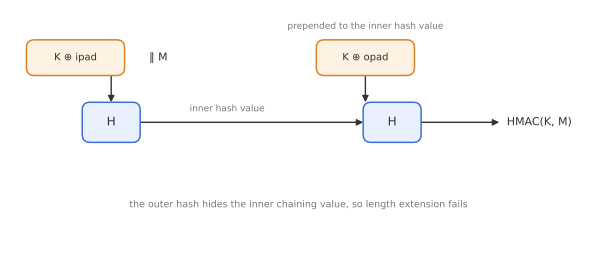
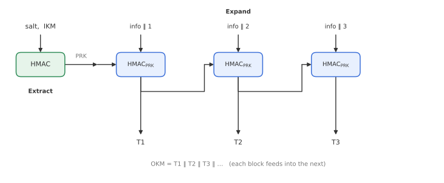
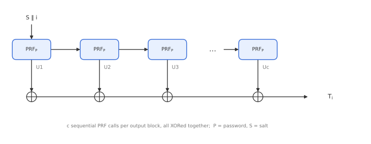
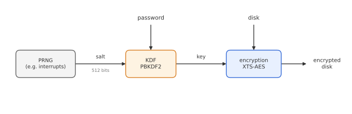

# Module 7: Key Derivation and Password Hashing

*How do we turn a password, or a messy shared secret, into strong cryptographic keys, and how does full-disk encryption put the pieces together?*

Cryptographic algorithms need uniformly random keys of a fixed length. What we actually have is often something else: a human-chosen password, a Diffie-Hellman shared value with algebraic structure, or one master key from which we need several independent keys. A **key derivation function (KDF)** bridges this gap. This module covers HMAC (the standard way to build a keyed function from SHA-2), the two most common KDFs, HKDF and PBKDF2, and then follows them into a complete disk encryption design.

---

## 1. What a KDF does

A KDF takes some secret input and a **salt**, and outputs one or more keys:

$$
K = \mathrm{KDF}(\text{secret}, \text{salt}, \text{context}, \ell).
$$

The secret can be a password or passphrase, a shared secret from a key exchange, or an existing key. Depending on the input, the KDF has different jobs:

- **Extraction:** concentrate the randomness of a non-uniform secret into a short uniform key.
- **Expansion:** stretch one good key into many independent keys (for example, separate encryption and MAC keys in each direction).
- **Key stretching / strengthening:** make each guess of a low-entropy password expensive, so that dictionary attacks are slow.
- **Key refresh:** derive a new key from the current one at regular intervals. If the KDF is one-way, an attacker who steals today's key cannot compute yesterday's keys. This is a form of **forward secrecy**.

The **salt** is a public random value stored alongside the result. It ensures that two users with the same password get different keys, and it defeats precomputed tables: an attacker cannot hash a dictionary once and reuse the result for every user.

Most KDFs are built from a hash function, usually via a PRF.

---

## 2. Building a PRF from a hash function

The most natural keyed construction is

$$
\mathrm{PRF}(K, M) = H(K \Vert M).
$$

With a **sponge** hash (SHA-3), this is secure: the key is simply absorbed first, and since the sponge has no length extension, it behaves like a random function (Module 8 develops this further).

With **Merkle-Damgård** hashes (MD5, SHA-1, SHA-2), it is **broken** by length extension (Module 6): from $H(K \Vert M)$, anyone can compute $H(K \Vert M \Vert \mathrm{pad} \Vert X)$ without knowing $K$.

---

## 3. HMAC

**HMAC** (Bellare, Canetti and Krawczyk, 1996; RFC 2104) fixes this by hashing twice, with the key mixed in at both ends:

$$
\mathrm{HMAC}(K, M) = H\Big( (K \oplus \mathrm{opad}) \;\Vert\; H\big( (K \oplus \mathrm{ipad}) \Vert M \big) \Big),
$$

where $\mathrm{ipad}$ is the byte `0x36` repeated and $\mathrm{opad}$ is the byte `0x5c` repeated, up to the hash block size.

The inner hash compresses the message; the outer hash, keyed with a different key-derived value, **hides the inner chaining value**, so length extension no longer works. HMAC is a PRF if the compression function of $H$ is a PRF in a suitable sense.

HMAC is everywhere (TLS, IPsec, JWT, TOTP codes), but it is a workaround for a structural weakness of Merkle-Damgård. It costs two hash evaluations, including two extra compression calls for the padded key blocks, even for tiny messages. It has been described, only half-jokingly, as "band-aid cryptography". With a sponge, a single keyed call is enough.

---

## 4. HKDF

**HKDF** (Krawczyk, 2010; RFC 5869) is the standard KDF for secrets that already have high entropy but may not be uniform, such as Diffie-Hellman outputs. It has two phases, both using HMAC.

**Extract:** turn the input keying material (IKM) into a pseudorandom key.

$$
PRK = \mathrm{HMAC}(\text{salt}, IKM).
$$

**Expand:** produce as many output blocks as needed, each depending on the previous one, an application-specific `info` string, and a counter byte.

$$
T_0 = \varepsilon, \qquad T_i = \mathrm{HMAC}\big(PRK,\; T_{i-1} \Vert \text{info} \Vert i\big), \qquad \mathrm{OKM} = T_1 \Vert T_2 \Vert \dots
$$

The `info` string provides **domain separation**: deriving with `info = "client write key"` and `info = "server write key"` gives independent keys from the same PRK. Because each $T_i$ feeds into the next (feed-forward), expansion is **sequential** and cannot be parallelised; in practice only a few blocks are needed, so this does not matter. TLS 1.3 derives its entire key schedule with HKDF.

---

## 5. PBKDF2 and password hashing

Passwords have **low entropy**. A user's password might come from a space of $2^{30}$ realistic candidates, not $2^{128}$. No KDF can add entropy, but it can make each guess expensive.

**PBKDF2** (PKCS #5, RFC 8018) does this by iterating a PRF (usually HMAC-SHA-256 or HMAC-SHA-512) $c$ times. Each output block $i$ is computed as

$$
U_1 = \mathrm{PRF}\big(P,\; S \Vert \langle i \rangle_{32}\big), \qquad U_j = \mathrm{PRF}(P, U_{j-1}),
$$

$$
T_i = U_1 \oplus U_2 \oplus \dots \oplus U_c, \qquad K = T_1 \Vert T_2 \Vert \dots
$$

where $P$ is the password, $S$ the salt, and $c$ the **iteration count**.

- The $c$ iterations within one block are **sequential**, which is the whole point: an attacker must do $c$ PRF evaluations per password guess.
- Different output blocks $T_1, T_2, \dots$ are independent and can be computed **in parallel**. (This is a known weakness: the defender usually computes them one after another, but an attacker who only needs to check the first block saves work.)

**Choosing $c$.** The cost per guess is linear in $c$, for the user and the attacker alike. A login that takes 0.5 seconds is acceptable to a user but means an attacker can only test about 2 passwords per second per CPU core. Modern guidance uses hundreds of thousands of iterations for HMAC-SHA-256.

**The limitation.** PBKDF2 only costs *time*, and GPUs and ASICs can run many iterations in parallel very cheaply. **Memory-hard** functions such as **scrypt** and **Argon2** (winner of the Password Hashing Competition, RFC 9106) also force the attacker to use a large amount of memory per guess, which is much more expensive to parallelise in hardware. Argon2id is now the recommended choice for new password storage.

---

## 6. Putting it together: disk encryption

Disk encryption is a good case study, because it combines everything from Modules 5 and 7. It is also the simplest kind of key management problem (Module 15), sometimes called a **one-dimensional** problem: there is only one party, who encrypts data for their own future self.

### Goals

- **Confidentiality** of everything on the disk.
- **No ciphertext expansion:** a sector of plaintext must fit in a sector of ciphertext.
- **Incrementality:** writing one sector must not require re-encrypting others.
- Ideally **authenticity**, so that tampering is detected. (With no space for tags, most practical systems give this up.)

### From password to disk key

The user remembers a password, but XTS needs a uniform 256- or 512-bit key. A naive design, $K = H(\text{password})$, has two problems: weak passwords can be guessed quickly, and two users (or two disks) with the same password get the same key. The complete design adds a salt and a slow KDF:

1. A **pseudorandom number generator (PRNG)**, seeded from unpredictable system events such as interrupt timings, produces a random **salt**.
2. The password and salt go into **PBKDF2**, which outputs the key.
3. The key is used with **XTS-AES** (Module 5) to encrypt the disk, sector by sector.

### VeraCrypt as an example

VeraCrypt (the successor of TrueCrypt) follows this design:

- a **512-bit salt** from its PRNG, stored in the volume header;
- **PBKDF2** with HMAC-SHA-512 (or other hash options) and a very high iteration count, to derive a header key;
- **XTS** mode with AES (or other block ciphers) for the data.

One more layer of indirection is important in practice: the password-derived key does not encrypt the data directly. It decrypts the volume **header**, which contains the randomly generated **master keys** that actually encrypt the disk. This means changing the password only requires re-encrypting the small header, not the whole disk. It is a small **key hierarchy**, an idea Module 15 develops in detail.

The weakest point remains the password itself. A high iteration count slows guessing down, but cannot save a password that is in the attacker's first million guesses.

---

## Key takeaways

- A **KDF** extracts randomness, expands keys with domain separation, stretches passwords, and can refresh keys for forward secrecy. A **salt** makes every derivation unique.
- $H(K \Vert M)$ is a secure PRF with a sponge, but not with Merkle-Damgård hashes.
- **HMAC** hashes twice with inner and outer key pads to defeat length extension.
- **HKDF** = extract (HMAC with salt) then expand (chained HMAC with `info` and a counter); used in TLS 1.3.
- **PBKDF2** iterates a PRF $c$ times per block to slow down password guessing; memory-hard **Argon2** and **scrypt** are stronger against GPU attacks.
- **Disk encryption** chains PRNG → salt → PBKDF2 → XTS-AES, usually with a master key protected by the password-derived key.

**Previous:** [Module 6: Hash Functions](06-hash-functions.md) · **Next:** [Module 8: Keyed Sponges and Duplexes](08-keyed-sponges.md)
