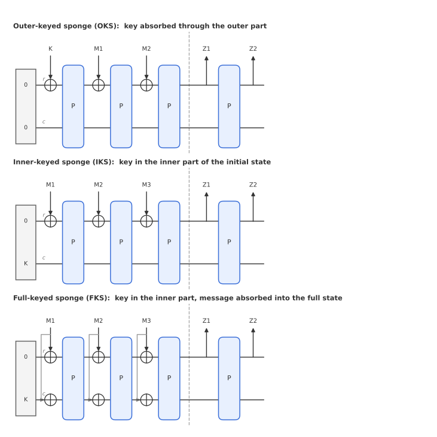
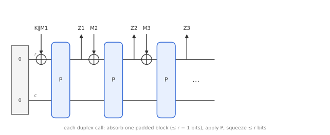
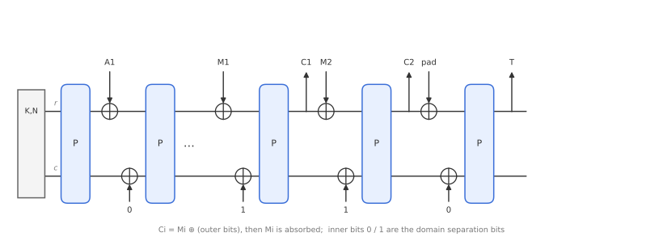
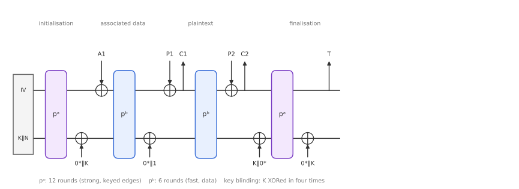
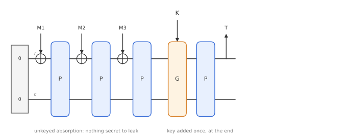

# Module 8: Keyed Sponges and Duplexes

*If one permutation can give us a hash function, can it give us MACs, stream ciphers and authenticated encryption too?*

Module 6 built SHA-3 from a single public permutation. This module adds a key. A **keyed sponge** gives a PRF, MAC and stream cipher with almost no extra design work, and its sibling, the **duplex**, gives lightweight authenticated encryption. The best-known result is **Ascon**, the winner of NIST's lightweight cryptography competition. We finish with the generic security bound and a variant designed to resist side-channel attacks.

---

## 1. Keyed sponges

Because a sponge has no length-extension weakness and is indifferentiable from a random oracle, the naive constructions just work:

$$
\begin{aligned}
\mathrm{PRF}(K, M) &= \mathrm{Sponge}(K \Vert M) \\
\mathrm{MAC}(K, M, t) &= \mathrm{Sponge}(K \Vert M) \text{ truncated to } t \text{ bits} \\
\mathrm{Stream}(K, D, \ell) &= \mathrm{Sponge}(K \Vert D) \text{ squeezed to } \ell \text{ bits}
\end{aligned}
$$

(with $K$ of fixed length, and $D$ a diversifier or nonce).

Compare this with Merkle-Damgård, where $H(K \Vert M)$ is broken (Module 6) and HMAC needs two hash calls (Module 7). In a sponge, the attacker never sees the full internal state, so there is no way to resume the computation from an output.

---

## 2. Three ways to key a sponge

Over time, the keyed sponge evolved to use the key more efficiently.

**Outer-keyed sponge (OKS).** The key is simply the first part of the input and is absorbed through the outer part, exactly as $\mathrm{Sponge}(K \Vert M)$ above. This is the most direct construction.

**Inner-keyed sponge (IKS).** The key is placed in the **inner part** of the initial state, instead of the all-zero value. Absorbing then starts immediately with message bits. This can be viewed as a sponge built from a keyed permutation (an Even-Mansour cipher).

**Full-keyed sponge (FKS).** The key sits in the inner part as in IKS, but message blocks are now absorbed into the **full** $b$-bit state, not just the $r$-bit outer part. This is called **full-state absorption**. Since the state already contains a secret, the attacker gains nothing by controlling the inner part, and the sponge absorbs $b$ instead of $r$ bits per permutation call: a big speed-up for MACs.

Generically, all three achieve essentially **the same level of security** (see Section 6).

---

## 3. The duplex

A sponge absorbs everything, then squeezes. For authenticated encryption, it is more convenient to **interleave** absorbing and squeezing: put in a block, get out a block, put in the next, and so on. This is the **duplex** construction.

Each **duplex call** takes an input block $M_i$ of at most $r - 1$ bits and returns an output block $Z_i$ of at most $r$ bits:

1. Pad $M_i$ (at least one padding bit, hence the $r-1$ limit) and XOR it into the outer part.
2. Apply $P$.
3. Output the first bits of the outer part as $Z_i$.

You can think of a duplex as a chain of mini-sponges, one per input block: absorb, squeeze, repeat. The output $Z_i$ depends on **all** inputs so far, $M_1, \dots, M_i$.

As with sponges, there are **unkeyed**, **outer-keyed** (the key goes into the first input block, $K \Vert M_1$) and **full-keyed** (the key initialises the inner part and inputs may cover the full state) duplex variants.

---

## 4. Security model for the duplex

What should a keyed duplex be compared with? A plain random oracle that returns fresh random bits for every call does not work: in the real duplex, the queries $(M_1, M_2, M_3)$ and $(M_1, M_2, M_4)$ must give the **same** $Z_1$ and $Z_2$, because the first two calls are identical. A random oracle would give unrelated answers, and the distinguisher would notice immediately.

The fix is to define the ideal object in terms of **paths**. The path of the $i$-th call is everything absorbed so far:

$$
\mathrm{path}_1 = M_1, \quad \mathrm{path}_2 = M_1 \Vert M_2, \quad \mathrm{path}_3 = M_1 \Vert M_2 \Vert M_3, \dots
$$

An **ideal duplex** $\mathrm{ID}^{\mathrm{RO}}$ answers each call with $Z_i = \mathrm{RO}(\mathrm{path}_i, |Z_i|)$. A repeated path gives the same answer; a new path gives fresh randomness.

The distinguisher then tries to tell the full-keyed duplex from the ideal duplex, **while also having access to the public permutation** $P$ in both worlds:

$$
\mathrm{Adv}^{\mathrm{duplex}}_{\mathrm{FKD}}(\mathcal{D}) = \Big|\Pr\big[\mathcal{D}^{\mathrm{FKD}_K,\,P^{\pm}} = 1\big] - \Pr\big[\mathcal{D}^{\mathrm{ID}^{\mathrm{RO}},\,P^{\pm}} = 1\big]\Big|.
$$

In the ideal world, $P$ is completely unrelated to the ideal duplex. That is fine: the key is secret, so the attacker cannot connect its own $P$ queries to the keyed object, unless it guesses the key or hits an internal state by luck. Those events are exactly what the security bound counts.

---

## 5. Authenticated encryption with the duplex

### SpongeWrap

**SpongeWrap** turns a keyed duplex into an AE scheme:

1. **Initialise** the state with the key and nonce, $(K, N)$.
2. **Absorb** the associated data blocks $A_1, \dots, A_a$, one duplex call each.
3. **Encrypt:** for each message block, the outer part acts as keystream: $C_i = M_i \oplus Z_i$. Then $M_i$ is absorbed, so that later output depends on it.
4. **Finalise:** squeeze the tag $T$, which depends on everything absorbed: all of $A$ and all of $M$.

**Domain separation bits.** Each duplex call also absorbs one extra bit, which signals what kind of block comes next:

- $0$: still absorbing associated data, or the call before the tag;
- $1$: start producing keystream for the message.

Without these bits, the boundary between associated data and message would be ambiguous. An attacker could, for example, ask for an encryption with associated data $A$ and empty message, then shift blocks between $A$ and $M$, and use the outputs to break confidentiality or forge, with just two queries. One bit per call removes this ambiguity.

**Decryption** mirrors encryption: initialise with $(K, N)$, absorb $A$, then for each block compute $M_i = C_i \oplus Z_i$ and absorb $M_i$, and finally squeeze $T'$ and check it against $T$.

**Nonce reuse.** As with GCM, the nonce must be unique per encryption: two messages under the same $(K, N, A)$ get the same first keystream block. Achieving nonce-misuse resistance requires going over the data twice, just like GCM-SIV (Module 4).

### Ascon

**Ascon** (Dobraunig, Eichlseder, Mendel and Schläffer) is a SpongeWrap-style AE scheme. It was selected as the winner of the NIST Lightweight Cryptography competition in 2023 and standardised in NIST SP 800-232. It is designed for small devices such as sensors, smart cards and IoT nodes.

| Parameter | Ascon-128 |
|---|---|
| State $b$ | 320 bits |
| Rate $r$ | 64 bits |
| Capacity $c$ | 256 bits |
| Key, nonce, tag | 128 bits each |
| Security | 128 bits |

Ascon differs from plain SpongeWrap in two important ways:

**Different permutations.** Ascon uses the same round function with different numbers of rounds. A strong permutation $p^a$ (12 rounds) is used at **initialisation and finalisation**, where the key is involved. A weaker, faster permutation $p^b$ (6 rounds) is used for **processing data**, where speed matters most.

**Key blinding.** The key is XORed into the state not only at the start, but again after initialisation and both before and after the final permutation. The reason is robustness: suppose an attacker recovers one intermediate state during data processing, for example via a side-channel leak in the weaker permutation. Since a permutation is invertible, in a plain sponge they could run it backwards to the initial state and read off the key, or forwards to forge tags. The extra key additions mean that knowing one internal state does not let the attacker reach the key or compute valid tags.

A domain separation bit is XORed in after the associated data, just as in SpongeWrap.

---

## 6. The generic security bound

The outer-keyed sponge, full-keyed sponge, outer-keyed duplex and full-keyed duplex all have, in drastically simplified form, the same security bound when $P$ is a random permutation:

$$
\mathrm{Adv} \;\lesssim\; \frac{M^2}{2^c} + \frac{M N}{2^c} + \frac{N}{2^k}.
$$

Here $M$ is the **data complexity** (the number of permutation calls inside the keyed construction, triggered by the attacker's queries), $N$ is the **time complexity** (offline calls the attacker makes to $P$ itself), $c$ is the capacity, and $k$ the key length. The scheme is secure as long as this sum is well below 1.

Each term corresponds to a concrete attack:

- $\frac{N}{2^k}$: **key guessing**. After one query, the attacker tries $N$ keys offline, each correct with probability $2^{-k}$ (just like exhaustive search in Module 1).
- $\frac{M^2}{2^c}$: **inner collisions** among the construction's own states. Among $M$ states, a birthday-bound collision in the $c$ secret bits lets the attacker extend two inputs identically.
- $\frac{MN}{2^c}$: **state guessing**. Each offline $P$ call is a guess at one of the $M$ secret inner states; any hit means the attacker can compute the construction's behaviour without the key.

For Ascon, with $c = 256$ and $k = 128$, all three terms stay negligible far beyond any realistic amount of data and computation.

> **How is this proven?** The proof views the full-keyed sponge as a chain of **Even-Mansour** ciphers (a public permutation with secret masks on input and output), and replaces them by secret random permutations at a cost of about $MN/2^c + N/2^k$. What remains is a "random duplex" with secret permutations, which behaves like the ideal duplex until an inner collision occurs, at a cost of about $M^2/2^c$. The triangle inequality adds the two steps.

---

## 7. Suffix-keyed sponge (SuKS)

Side-channel attacks measure power consumption, electromagnetic radiation or timing while a device computes with a secret key. In a full-keyed sponge, the key is in the state from the very beginning, and every permutation call mixes it with attacker-chosen message data. Each call leaks a little, and over many calls the key can be extracted. Protecting every call (for example with masking) is expensive.

The **suffix-keyed sponge** (SuKS) moves the key to the **end**:

1. Absorb the message with an **unkeyed** sponge. No secret is involved, so there is nothing to leak.
2. Combine the key with part of the state: $s$ bits of the state and the key $K$ go into a simple function $G$ (often just XOR).
3. Apply $P$ once more and squeeze a $t$-bit tag.

This is essentially **hash-then-MAC** inside a single sponge: first hash $M$, then key it. Only the last one or two permutation calls involve the key, so only they need side-channel protection.

| | SuKS vs full-keyed sponge | SuKS vs separate hash-then-MAC |
|---|---|---|
| Advantages | leakage limited to the final call(s) | state of the keyed function is half as large; $G$ need not be cryptographically strong (XOR suffices); one primitive for both steps |
| Disadvantages | no full-state absorption (the state is public during absorption, so the attacker could control all of it), so absorbing is slower | none significant |

Typical parameters are $s = t = c/2$.

---

## Key takeaways

- With a sponge, $\mathrm{Sponge}(K \Vert M)$ is directly a PRF, MAC or stream cipher; no HMAC-style workaround is needed.
- Keys can go in the outer part, the inner part, or the inner part with **full-state absorption** (fastest); all have similar generic security.
- A **duplex** interleaves absorbing and squeezing; its ideal counterpart answers based on the **path** of all inputs so far.
- **SpongeWrap** and **Ascon** build AE from a duplex; **domain separation bits** are essential.
- Ascon uses a strong permutation at the edges, a weaker one in the middle, and **key blinding** for robustness against state recovery.
- Generic bound: $M^2/2^c + MN/2^c + N/2^k$, one term each for inner collisions, state guessing and key guessing.
- The **suffix-keyed sponge** adds the key only at the end, limiting side-channel leakage.

**Previous:** [Module 7: Key Derivation and Password Hashing](07-key-derivation.md) · **Next:** [Module 9: Public-Key Foundations](09-public-key-foundations.md)
