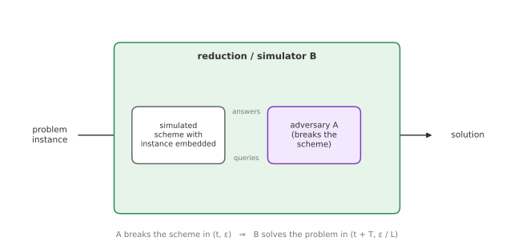
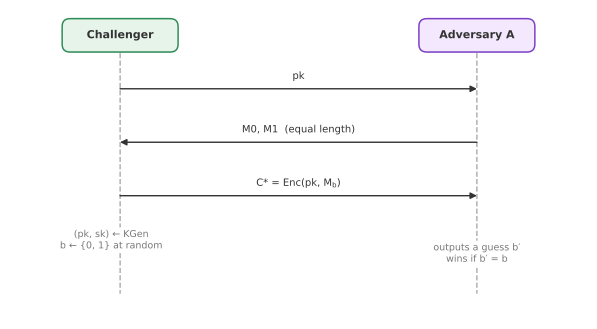

# Module 9: Public-Key Foundations

*What does it mean for a public-key scheme to be secure, how do reductions "prove" it, and why is textbook RSA not encryption you should ever use?*

Everything so far assumed that the two parties already share a secret key. Public-key cryptography removes that assumption: anyone can encrypt to Alice or verify her signatures using her **public key**, while only Alice holds the matching **private key**. This module sets up the foundations for Part B: what public-key primitives do, what "hard problem" means, how security reductions work and what they cost, and the standard security notions IND-CPA and IND-CCA. It ends with attacks that show why plain ("textbook") RSA fails them.

---

## 1. The public-key toolbox

**Public-key encryption (PKE).** Anyone uses the receiver's public key to turn data into a ciphertext; only the holder of the private key can recover the data.

**Digital signatures.** The signer uses their private key to sign a message; anyone can verify the signature using the signer's public key and the message.

**Key encapsulation (KEM) and key exchange (KEX).** The goal is a **shared symmetric key**:

- A **KEM** (simplified): encrypt a fresh symmetric key with the receiver's public key; the receiver decrypts it with their private key.
- A **KEX** is a protocol in which two parties agree on a shared key, for example Diffie-Hellman style, or built from a KEM.

Public-key operations are much slower than symmetric ones and have larger ciphertexts, so in practice they are used to establish a symmetric key, and the actual data is protected with AE (Module 4). This is called **hybrid encryption**.

Public-key cryptography also enables many other primitives, including blind and group signatures, commitments (Module 12), identification schemes, secret sharing, threshold and homomorphic encryption, identity- and attribute-based encryption, multiparty computation and digital cash. Real protocols built on it include TLS (HTTPS), SSH, IPsec/IKE, WireGuard, Signal, Wi-Fi (IEEE 802.11), DNSSEC, EMV payment cards and electronic voting.

---

## 2. Hardness assumptions

Unlike AES, a public-key scheme has mathematical structure, and its security is based on a **hard problem**: a problem we believe no efficient algorithm can solve. Hardness is defined relative to a **security parameter** $\lambda$ (roughly, the key size), and "efficient" means running in time polynomial in $\lambda$. A probability is **negligible**, written $\mathrm{negl}(\lambda)$, if it shrinks faster than any inverse polynomial.

There are two flavours.

**Computational problems.** Given a problem instance, *compute* the solution. The problem is hard if every polynomial-time algorithm succeeds with only negligible probability.

> **Computational Diffie-Hellman (CDH).** Let $G$ be a cyclic group with generator $g$. Given $g$, $g^a$ and $g^b$ for unknown random $a, b$, compute $g^{ab}$.

**Decisional problems.** Given an instance and a candidate answer $Z$, *decide* whether $Z$ is correct. The answer is a single bit, so guessing already succeeds half the time; the problem is hard if no efficient algorithm has more than negligible **advantage** over guessing.

> **Decisional Diffie-Hellman (DDH).** Given $g$, $g^a$, $g^b$ and $Z$, decide whether $Z = g^{ab}$ or $Z$ is a random group element.

If you can solve CDH, you can solve DDH: compute $g^{ab}$ and compare with $Z$. So DDH is the *easier* problem, and assuming DDH is hard is a **stronger** assumption than assuming CDH is hard. (There are groups where CDH is believed hard but DDH is easy.)

A note on choosing problems: cryptography needs problems that are hard **on average**, for randomly generated instances, not merely hard in the worst case. NP-hard problems such as the travelling salesman are hard in the worst case, but random instances are often easy, which is why they are not used directly. Factoring, discrete logarithms and lattice problems are used because their random instances are believed to be hard.

---

## 3. Security proofs by reduction

A public-key security proof is usually a **reduction**: we show that breaking the scheme is at least as hard as solving the underlying problem.

**The security model** specifies what the attacker can do (which oracles it can query, what it sees) and what it must achieve to "win".

**The proof is by contradiction.** Suppose an adversary $\mathcal{A}$ breaks the scheme. We build an algorithm, the **simulator** or **reduction** $\mathcal{B}$, that uses $\mathcal{A}$ as a subroutine to solve the hard problem. Since we assume the problem cannot be solved efficiently, no such $\mathcal{A}$ can exist.

How $\mathcal{B}$ works:

1. $\mathcal{B}$ receives an instance of the hard problem.
2. It embeds that instance into a **simulated** copy of the scheme (for example, as the public key, or inside a challenge ciphertext) and plays the security game with $\mathcal{A}$, answering all of its queries.
3. When $\mathcal{A}$ breaks the simulated scheme, $\mathcal{B}$ extracts a solution to the problem from $\mathcal{A}$'s output.

For this to work, the simulation must be **indistinguishable** from the real scheme, up to a negligible statistical difference. Otherwise $\mathcal{A}$ might notice and refuse to cooperate.

### Reduction cost and security loss

Suppose $\mathcal{A}$ breaks the scheme in time $t$ with advantage $\varepsilon$. The reduction then solves the hard problem in time $t'$ with advantage $\varepsilon'$, where

$$
t' = t + T, \qquad \varepsilon' = \frac{\varepsilon}{L}.
$$

- $T$ is the **reduction cost**: the extra time $\mathcal{B}$ spends simulating.
- $L$ is the **security loss**. It appears because $\mathcal{B}$ often has to guess something in advance, for instance which of $\mathcal{A}$'s queries will be the one it attacks, and the reduction only works when the guess is right.

The size of $L$ matters a lot:

- **Tight reduction:** $L$ is a constant, or grows sub-linearly in the number of queries. Breaking the scheme is essentially as hard as the problem.
- **Loose reduction:** $L$ grows at least linearly in the number of queries $q$ (for example, $L = q_H$, the number of hash queries, which could be $2^{60}$). The guarantee then says: "if the problem offers 128 bits of security, the scheme offers $128 - \log_2 L$ bits". With a large $L$, the scheme may be significantly less secure than the problem, unless the parameters are increased to compensate.

The tightness of reductions is a widely overlooked issue in public-key cryptography: a scheme can be "provably secure" with a bound that says almost nothing at the parameters actually used.

---

## 4. Public-key encryption

A PKE scheme consists of three algorithms:

- $\mathrm{KGen}(1^\lambda) \to (pk, sk)$, **probabilistic**: generates a key pair from the security parameter.
- $\mathrm{Enc}(pk, M; r) \to C$, usually **probabilistic**, using fresh randomness $r$. (Deterministic encryption is possible, but see below.)
- $\mathrm{Dec}(sk, C) \to M$ or $\bot$, **deterministic**: returns the message, or $\bot$ for an invalid ciphertext.

**Correctness:** if everything is generated honestly, decryption returns the original message, $\mathrm{Dec}(sk, \mathrm{Enc}(pk, M)) = M$, possibly except with a negligible **decryption error** probability. (Some post-quantum schemes have small decryption error, which matters for their security proofs, see Module 10.)

---

## 5. IND-CPA: the baseline

A very weak notion would be "a passive attacker cannot recover the message". But in public-key encryption, *anyone* can encrypt, because the key is public. So we must at least assume the attacker can encrypt messages of its choice. This is a **chosen-plaintext attack (CPA)**.

**The IND-CPA game:**

1. The challenger generates $(pk, sk)$ and gives $pk$ to the adversary $\mathcal{A}$.
2. $\mathcal{A}$ chooses two messages $M_0, M_1$ of equal length.
3. The challenger picks a random bit $b$ and returns the **challenge ciphertext** $C^* = \mathrm{Enc}(pk, M_b)$.
4. $\mathcal{A}$ outputs a guess $b'$.

The scheme is **IND-CPA secure** if every efficient $\mathcal{A}$ has only negligible advantage:

$$
\mathrm{Adv}^{\mathrm{ind\text{-}cpa}}(\mathcal{A}) = \Big|\Pr[b' = b] - \tfrac{1}{2}\Big| \le \mathrm{negl}(\lambda).
$$

Intuitively: the ciphertext reveals **nothing** about the plaintext, not even one bit, beyond its length.

**Deterministic encryption can never be IND-CPA secure.** The adversary simply computes $\mathrm{Enc}(pk, M_0)$ itself and compares it with $C^*$. So every IND-CPA scheme must be randomised. IND-CPA is considered the minimum requirement for any new public-key encryption scheme.

### An IND-CPA scheme: hashed ElGamal

Let $G$ be a cyclic group of prime order with generator $g$, and let $\mathcal{G}$ be a hash function from group elements to $L$-bit strings, modelled as a random oracle.

- **KGen:** choose a random secret $s$; set $pk = (g, h = g^s)$, $sk = s$.
- **Enc:** choose a random $r$; compute $C_1 = g^r$, $\kappa = \mathcal{G}(h^r)$, and $C_2 = M \oplus \kappa$. Output $C = (C_1, C_2)$.
- **Dec:** compute $\kappa = \mathcal{G}(C_1^{\,s})$ and return $M = C_2 \oplus \kappa$.

Correctness: $C_1^{\,s} = g^{rs} = h^r$.

**Security.** $\kappa$ acts as a **one-time pad** on $M$. Since $\mathcal{G}$ is a random oracle, $\kappa$ is a uniformly random string unless the adversary queries $\mathcal{G}$ at exactly $h^r = g^{rs}$. But computing $g^{rs}$ from $g^r$ and $g^s$ is the CDH problem. So **if CDH is hard, hashed ElGamal is IND-CPA secure in the random oracle model**.

(If the adversary somehow learned $r$, it could compute $\kappa = \mathcal{G}(h^r)$ itself from public values and decrypt. Security relies entirely on the randomness $r$ staying hidden.)

---

## 6. IND-CCA: active attackers

IND-CPA assumes the attacker can only encrypt. Real attackers can also **send crafted ciphertexts** to the legitimate receiver and observe how it reacts: whether it returns an error, how long it takes, or what it outputs. This is a **chosen-ciphertext attack (CCA)**.

**The IND-CCA2 game** (also simply written IND-CCA) extends IND-CPA with a **decryption oracle**:

- $\mathcal{A}$ may ask for decryptions of any ciphertexts, **before and after** receiving the challenge $C^*$.
- The only restriction is that it may not ask for the decryption of $C^*$ itself.

IND-CCA2 is the standard requirement for encryption used in practice, especially for **transporting keys** in protocols. Bleichenbacher's 1998 attack, which decrypts RSA PKCS #1 v1.5 ciphertexts by watching whether a server reports a padding error, is the classic real-world example of why CPA security is not enough (Module 14 lists the attacks it inspired against TLS).

---

## 7. Textbook RSA

**Key generation:**

1. Choose two large primes $p, q$ of similar size.
2. Compute $N = pq$ and $\varphi(N) = (p - 1)(q - 1)$.
3. Choose $e$ with $\gcd(e, \varphi(N)) = 1$.
4. Compute $d$ with $ed \equiv 1 \pmod{\varphi(N)}$.
5. Public key $pk = (N, e)$; private key $sk = d$.

**Encryption:** $C = M^e \bmod N$. **Decryption:** $M = C^d \bmod N$.

Textbook RSA is **deterministic**, so it cannot be IND-CPA secure. But it is worse than that: it is **multiplicative**,

$$
(M_1 M_2)^e = M_1^e \cdot M_2^e \pmod N,
$$

and this structure enables two concrete attacks.

### Attack 1: meet-in-the-middle on short messages

A common use of RSA is to encrypt a short symmetric key, say $M < 2^L$ with $L = 64$. Since $M$ is small compared with $N$, the ciphertext is not "full-size" in any sense, but the attacker would still seem to need $2^L$ guesses. Not so.

With noticeable probability, $M$ factors as $M = M_1 \cdot M_2$ with both $M_1, M_2 \le 2^{L/2}$. Then $C = M_1^e \cdot M_2^e \bmod N$, so $C / M_2^e = M_1^e$.

1. Build a sorted table of $j^e \bmod N$ for $j = 1, \dots, 2^{L/2}$.
2. For each $i = 1, \dots, 2^{L/2}$, compute $C \cdot (i^e)^{-1} \bmod N$ and look it up in the table.
3. A match $C / i^e = j^e$ gives $M = i \cdot j$.

Time and memory are both about $2^{L/2}$: a 64-bit key falls with roughly $2^{32}$ work instead of $2^{64}$. The attack **halves the security level** without any interaction, just from the ciphertext.

### Attack 2: chosen-ciphertext decryption

An active attacker who wants to decrypt $C = M^e \bmod N$, and can get the receiver to decrypt other ciphertexts:

1. Choose a random $R$ and compute $C' = C \cdot R^e \bmod N$. This looks like an unrelated ciphertext.
2. Ask the receiver to decrypt $C'$. They return $C'^{\,d} = M \cdot R \bmod N$.
3. Divide by $R$ to get $M$.

**One decryption query** recovers the message. Textbook RSA is therefore not IND-CCA secure, and is not even close.

The fixes are to randomise and to destroy the multiplicative structure with a hash, before applying RSA. RSA-OAEP does this for encryption, and an RSA-based KEM can simply encrypt a random full-size value and hash it into a key (Victor Shoup's RSA-KEM). Module 10 shows the general method for turning weak schemes into IND-CCA ones.

---

## Key takeaways

- Public-key cryptography provides **PKE**, **signatures**, and **KEMs/KEX**; in practice it establishes symmetric keys for hybrid encryption.
- Security rests on **hard problems**, computational (CDH) or decisional (DDH); decisional assumptions are stronger.
- **Reductions** turn an attacker on the scheme into a solver for the problem; the **security loss** $L$ decides how meaningful the proof is (tight vs loose).
- **IND-CPA** (the baseline) requires randomised encryption; **IND-CCA2** adds a decryption oracle and is what real protocols need.
- **Hashed ElGamal** is IND-CPA under CDH in the random oracle model.
- **Textbook RSA** is deterministic and multiplicative: a meet-in-the-middle attack halves its security for short messages, and one chosen ciphertext decrypts any message.

**Previous:** [Module 8: Keyed Sponges and Duplexes](08-keyed-sponges.md) · **Next:** [Module 10: KEMs and the Fujisaki-Okamoto Transforms](10-kems-fo-transforms.md)
