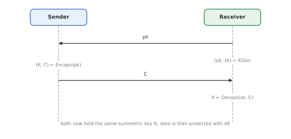
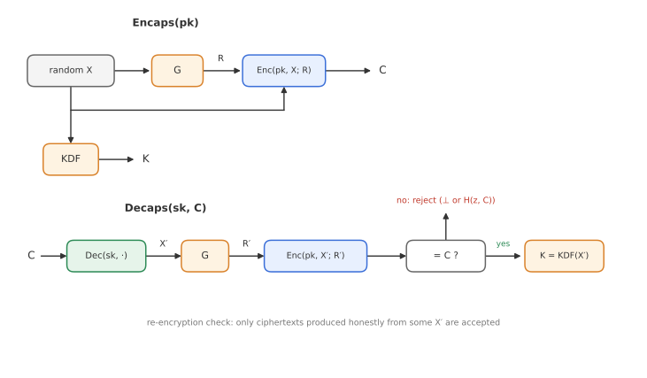

# Module 10: KEMs and the Fujisaki-Okamoto Transforms

*How do we turn a weak public-key scheme into one that survives active attacks, and why does every post-quantum KEM use the same trick?*

Module 9 showed that IND-CCA2 security is what real systems need, and that schemes like textbook RSA or plain ElGamal fall far short. Designing an IND-CCA2 scheme directly is hard. Instead, the standard approach is to start from a scheme with a **weak** security property and apply a generic **transform** that upgrades it. This module introduces **key encapsulation mechanisms (KEMs)**, the form in which public-key encryption is actually used today, and the two **Fujisaki-Okamoto (FO)** transforms. The second one is at the heart of ML-KEM (Kyber), the NIST post-quantum standard.

---

## 1. The first Fujisaki-Okamoto transform

Start from an IND-CPA secure PKE scheme $(\mathrm{KGen}, \mathrm{Enc}, \mathrm{Dec})$ and a hash function $H$ modelled as a random oracle. The idea is to **derandomise** encryption: the randomness used to encrypt is computed from the message itself, so that the receiver can recompute and check it.

**Encryption:** choose a random string $R$ and compute

$$
C = \mathrm{Enc}\big(pk,\; M \Vert R;\; H(M \Vert R)\big),
$$

i.e. encrypt $M \Vert R$ using $H(M \Vert R)$ as the encryption randomness.

**Decryption:**

1. Decrypt: $M' \Vert R' = \mathrm{Dec}(sk, C)$.
2. **Re-encrypt** and check: if $\mathrm{Enc}\big(pk, M' \Vert R'; H(M' \Vert R')\big) = C$, output $M'$. Otherwise output $\bot$.

The primes on $M'$ and $R'$ are deliberate: if $C$ was honestly generated, they equal $M$ and $R$, but if an attacker modified $C$ (or there was a decryption error) they might not.

**Why it helps.** In a chosen-ciphertext attack, the adversary submits crafted ciphertexts and learns from the answers. After this transform, a ciphertext is only accepted if it is *exactly* what honest encryption of some $M' \Vert R'$ would produce, which essentially requires knowing $M'$ and $R'$ and having queried $H$ on them. So the decryption oracle only answers questions whose answers the adversary already knows. It becomes useless.

**Result:** if the underlying PKE is IND-CPA secure, the transformed scheme is IND-CCA2 secure in the random oracle model. The reduction loses a factor of about $q_H$, the number of hash queries: the reduction must guess which of the adversary's $H$ queries relates to the challenge.

**Drawback:** it starts from IND-CPA, which is already a fairly strong assumption. We would prefer a transform that needs less.

---

## 2. Key encapsulation mechanisms

In practice, public-key encryption is almost never used to encrypt data directly. It is used to transport a symmetric key, which then protects the data with AE. A **KEM** captures exactly this, and nothing more.

A KEM has three algorithms:

- $\mathrm{KGen}(1^\lambda) \to (pk, sk)$, as for PKE.
- $\mathrm{Encaps}(pk) \to (K, C)$: using fresh randomness, produces a symmetric key $K$ from a key space $\mathcal{K}$, and an **encapsulation** $C$ of it. Only $C$ is sent; the sender keeps $K$.
- $\mathrm{Decaps}(sk, C) \to K$ or $\bot$: recovers $K$, or rejects an invalid encapsulation.

**Correctness:** $\mathrm{Decaps}(sk, C) = K$ for honestly generated $(K, C)$, again with possibly a negligible error probability.

Note the difference from PKE: the sender does **not** choose the key. The KEM produces a random key for them. This is all a key transport needs, and it is easier to make secure.

**Example: RSA-KEM.** Choose a uniformly random $x \in \mathbb{Z}_N$, send $C = x^e \bmod N$, and use $K = H(x)$. Because $x$ is full-size and random, the meet-in-the-middle attack from Module 9 does not apply, and the hash destroys the multiplicative structure. Under the RSA assumption, RSA-KEM is IND-CCA2 secure in the random oracle model.

### IND-CCA security for KEMs

1. The challenger generates $(pk, sk)$, computes $(K_0, C^*) \leftarrow \mathrm{Encaps}(pk)$, and also picks an independent **random** key $K_1 \in \mathcal{K}$.
2. It flips a bit $b$ and gives the adversary $(pk, C^*, K_b)$.
3. The adversary may query a **decapsulation oracle** on any $C \neq C^*$.
4. It outputs a guess $b'$, and wins if $b' = b$.

The adversary must decide whether the key it was given is the **real** encapsulated key or a **random** one. If it cannot tell, then the KEM key is as good as a uniformly random key, and it is safe to use for symmetric encryption.

### KEM + DEM

To encrypt a message, combine a KEM with a **data encapsulation mechanism (DEM)**, which is just a symmetric AE scheme:

$$
(K, C_1) \leftarrow \mathrm{Encaps}(pk), \qquad C_2 = \mathrm{AE}_K(M), \qquad \text{send } (C_1, C_2).
$$

If the KEM is IND-CCA secure and the DEM is a secure AE scheme, the combination is an IND-CCA secure PKE (Cramer and Shoup). This **KEM-DEM** paradigm is how public-key encryption is used in practice, for example in HPKE (RFC 9180).

---

## 3. One-wayness: a weaker starting point

**OW-CPA** (one-wayness under chosen-plaintext attack) is a much weaker property than IND-CPA:

> Given $pk$ and $C = \mathrm{Enc}(pk, M)$ for a **uniformly random** message $M$, no efficient adversary can recover $M$, except with negligible probability.

Compare the two:

- **IND-CPA:** the adversary picks two messages and must not learn even one bit about which one was encrypted.
- **OW-CPA:** the message is random, not chosen by the adversary, and the adversary must recover **all** of it.

Many schemes are OW-CPA but not IND-CPA. Textbook RSA is OW-CPA under the RSA assumption (inverting $x^e$ for random $x$ is exactly the RSA problem), and so are the raw ("CPA-only") versions of many lattice- and code-based schemes. So a transform that starts from OW-CPA is far more broadly applicable.

---

## 4. The second Fujisaki-Okamoto transform (KEM version)

The modern FO transform builds an IND-CCA KEM from an OW-CPA public-key encryption scheme. It uses two hash functions, both modelled as random oracles: $G$ to derive encryption randomness, and a KDF (or hash $H$) to derive the final key. In practice these must be **domain-separated**, for example by prefixing different constants, so that their outputs are independent.

**KGen:** as for the underlying PKE.

**Encaps(pk):**

1. Choose a uniformly random message $X$.
2. Derive the randomness: $R = G(X)$.
3. Encrypt deterministically: $C = \mathrm{Enc}(pk, X; R)$.
4. Derive the key: $K = \mathrm{KDF}(X)$ (often $\mathrm{KDF}(X, C)$).
5. Output $(K, C)$.

**Decaps(sk, C):**

1. Decrypt: $X' = \mathrm{Dec}(sk, C)$. If this fails, reject.
2. Recompute the randomness: $R' = G(X')$.
3. **Re-encrypt:** if $\mathrm{Enc}(pk, X'; R') \neq C$, reject.
4. Otherwise output $K = \mathrm{KDF}(X')$.

**Result:** if the PKE is OW-CPA secure (and has negligible decryption error), the FO KEM is IND-CCA2 secure in the random oracle model.

### Why the re-encryption check works

Think about the reduction, which must answer the adversary's decapsulation queries **without knowing $sk$**. It keeps a list of every query the adversary makes to $G$. When asked to decapsulate $C$, it searches that list for some $X$ such that $\mathrm{Enc}(pk, X; G(X)) = C$:

- If it finds one, it returns $\mathrm{KDF}(X)$, exactly as the real Decaps would.
- If not, it rejects. This is almost always the right answer: producing a ciphertext that passes the re-encryption check without having queried $G$ on its plaintext would mean guessing $G$'s random output.

So the decapsulation oracle can be simulated from the adversary's own hash queries, and it gives the adversary nothing new. Meanwhile, to distinguish the real key $K = \mathrm{KDF}(X^*)$ from random, the adversary would need to query the KDF on $X^*$, which means recovering $X^*$ from $C^*$, which breaks OW-CPA.

### Explicit vs implicit rejection

What should Decaps output when the check fails?

- **Explicit rejection:** output $\bot$. Simple, but it tells the attacker that the ciphertext was invalid, and any timing difference between the failure paths can leak information.
- **Implicit rejection:** output a **pseudorandom key** $K = H(z, C)$, where $z$ is an extra secret value stored with $sk$. An invalid ciphertext then yields a key that looks valid but is unrelated to anything, and the error only shows up later, when the symmetric decryption fails. This removes a decryption-failure oracle and is preferred for constant-time implementations.

**ML-KEM** (formerly CRYSTALS-Kyber), standardised by NIST in FIPS 203 in 2024, is a lattice-based OW-CPA scheme wrapped in an FO transform with implicit rejection. Most other post-quantum KEMs follow the same pattern. This is why FO, a 1999 idea that was rarely used for decades, is now everywhere.

---

## Key takeaways

- The **first FO transform** derandomises encryption with $H(M \Vert R)$ and re-encrypts on decryption to check validity; it lifts IND-CPA to IND-CCA2 with a loss of about $q_H$.
- A **KEM** produces a random key and its encapsulation; KEM IND-CCA security means the real key is indistinguishable from random, even with a decapsulation oracle.
- **KEM + DEM** (an AE scheme) gives IND-CCA public-key encryption; this is how PKE is used in practice.
- **OW-CPA** only asks that random messages cannot be fully recovered, a much weaker and more widely available property.
- The **FO KEM transform** turns an OW-CPA scheme into an IND-CCA2 KEM using $R = G(X)$, re-encryption and $K = \mathrm{KDF}(X)$.
- **Implicit rejection** returns a pseudorandom key instead of $\bot$; ML-KEM (FIPS 203) uses it.

**Previous:** [Module 9: Public-Key Foundations](09-public-key-foundations.md) · **Next:** [Module 11: Digital Signatures](11-digital-signatures.md)
