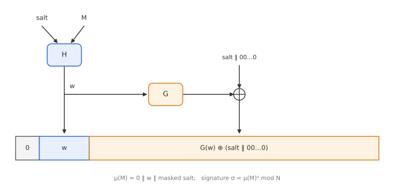

# Module 11: Digital Signatures

*What does it mean for a signature to be unforgeable, why is "sign with RSA" not enough, and what do real RSA signature standards add?*

A digital signature is the public-key counterpart of a MAC (Module 3): only the holder of the private key can produce it, but **anyone** with the public key can check it. That gives a property MACs cannot offer: a third party can verify who signed, so the signer cannot later deny it (**non-repudiation**). This module defines signature security, shows how textbook RSA signatures fail it, builds the provably secure **RSA-FDH** and **RSA-PSS**, and compares them with the RSA signature formats used in practice.

---

## 1. Definition

A signature scheme consists of three algorithms:

- $\mathrm{KGen}(1^\lambda) \to (pk, sk)$.
- $\mathrm{Sign}(sk, M) \to \sigma$.
- $\mathrm{Vf}(pk, M, \sigma) \to$ accept or $\bot$: accepts if $\sigma$ is a valid signature on $M$ under $pk$.

**Correctness:** honestly generated signatures always verify, $\mathrm{Vf}(pk, M, \mathrm{Sign}(sk, M)) = \text{accept}$.

There are two kinds of attacker. A **passive** attacker only observes signed messages. An **active** attacker can get the signer to sign messages of its choice, for example by submitting documents to an automated signing service. Security must hold against the active attacker.

---

## 2. EUF-CMA security

The baseline security notion is **existential unforgeability under chosen-message attacks (EUF-CMA)**.

1. The challenger generates $(pk, sk)$ and gives $pk$ to the adversary $\mathcal{A}$.
2. $\mathcal{A}$ may ask a **signing oracle** for signatures on any messages $M_1, M_2, \dots$ of its choice.
3. Finally, $\mathcal{A}$ outputs a pair $(M^*, \sigma^*)$.
4. $\mathcal{A}$ **wins** if $\sigma^*$ is valid for $M^*$ and $M^*$ was **never** queried to the signing oracle.

The scheme is EUF-CMA secure if every efficient adversary wins with only negligible probability.

The word **existential** is important: the attacker wins by forging a signature on *any* new message, even a meaningless one. This is deliberately strong. We do not want to reason about which messages are "meaningful" in some future application.

---

## 3. Textbook RSA signatures

With the RSA key pair from Module 9, $pk = (N, e)$ and $sk = d$:

$$
\mathrm{Sign}: \quad \sigma = M^d \bmod N, \qquad \mathrm{Vf}: \quad \text{accept iff } \sigma^e \bmod N = M.
$$

Two simple attacks show this is not EUF-CMA secure.

### Key-only existential forgery

The attacker needs nothing but the public key:

1. Pick any $\sigma \in \mathbb{Z}_N$.
2. Compute $M = \sigma^e \bmod N$.
3. Output $(M, \sigma)$.

This verifies by construction. The attacker cannot choose $M$ (it will look random), but EUF-CMA counts it as a forgery. This attack applies to **any** scheme where the verifier can efficiently reconstruct the message from the signature alone.

### Chosen-message universal forgery

RSA is **multiplicative**:

$$
\mathrm{Sign}(M_1) \cdot \mathrm{Sign}(M_2) = M_1^d M_2^d = (M_1 M_2)^d = \mathrm{Sign}(M_1 \cdot M_2) \pmod N.
$$

To forge a signature on **any** target message $M$:

1. Choose some $M_1$ invertible mod $N$ and set $M_2 = M \cdot M_1^{-1} \bmod N$, so that $M = M_1 M_2$.
2. Ask the signing oracle for $\sigma_1 = \mathrm{Sign}(M_1)$ and $\sigma_2 = \mathrm{Sign}(M_2)$.
3. Output $\sigma = \sigma_1 \sigma_2 \bmod N$, a valid signature on $M$, which was never queried.

This works against any scheme with this multiplicative property.

Both attacks exploit algebraic structure. The fix is the same idea as for encryption: **hash** the message into the domain before applying RSA.

---

## 4. Full Domain Hash (FDH)

### Trapdoor permutations

A **trapdoor (one-way) permutation** $\mathcal{T}$ is a permutation $\pi$ of a domain $D$ that is:

- easy to compute for anyone: $\mathcal{T}(pk, x) = \pi(x)$;
- hard to invert without the trapdoor: given $y$, finding $x$ with $\pi(x) = y$ is infeasible;
- easy to invert with the trapdoor $sk$: $\mathcal{T}(sk, y) = \pi^{-1}(y)$.

RSA is the standard example: $\pi(x) = x^e \bmod N$, with trapdoor $\pi^{-1}(y) = y^d \bmod N$. The **RSA assumption** says that given $N$, $e$ and a random $y = x^e \bmod N$, it is hard to find $x$.

### The construction

We also need a hash function $\mathrm{FDH} : \{0,1\}^* \to D$ that maps messages onto the **entire domain** $D$ of the permutation (hence "full domain"), modelled as a random oracle.

- **KGen:** generate a trapdoor permutation key pair $(pk, sk)$.
- **Sign:** compute $y = \mathrm{FDH}(M)$ and $\sigma = \mathcal{T}(sk, y)$. For RSA, $\sigma = \mathrm{FDH}(M)^d \bmod N$.
- **Vf:** compute $y' = \mathcal{T}(pk, \sigma)$ and accept iff $y' = \mathrm{FDH}(M)$. For RSA, check $\sigma^e = \mathrm{FDH}(M) \bmod N$.

Both attacks now fail:

- Key-only forgery gives a pair $(y, \sigma)$ with $\sigma^e = y$, but the attacker would also need a message $M$ with $\mathrm{FDH}(M) = y$, which means inverting a random oracle.
- Multiplicativity no longer helps, because $\mathrm{FDH}(M_1)\cdot\mathrm{FDH}(M_2)$ has no relation to $\mathrm{FDH}(M_1 M_2)$.

**Theorem.** If the RSA assumption holds, RSA-FDH is EUF-CMA secure in the random oracle model.

**The proof idea.** The reduction is given an RSA challenge $y^*$ and must find its $e$-th root. It programs the random oracle: for most messages, it picks a random $x$ and answers $\mathrm{FDH}(M) = x^e$, so it knows the signature ($x$) and can answer signing queries. For **one** message, it answers $\mathrm{FDH}(M) = y^*$, hoping that this is the message the adversary will forge. If so, the forgery is the $e$-th root of $y^*$.

The reduction must guess which hash query will be forged, so it loses a factor of about the number of queries. With Coron's refined analysis the loss is about $q_S$, the number of signing queries. This is a **loose** reduction (Module 9).

---

## 5. RSA signatures in practice

Real-world RSA signature standards all follow the pattern $\sigma = \mu(M)^d \bmod N$, where $\mu$ is an **encoding (padding) function**. The difference between schemes is entirely in $\mu$. The main goal of the encoding is to resist multiplicative forgeries, but historically many choices were ad hoc.

### Ad hoc designs (no security proof)

| Standard | Encoding $\mu(M)$ (simplified) | Status |
|---|---|---|
| ISO 9796-1 / 9796-2 | `6a` ‖ (part of $M$) ‖ $H(M)$ ‖ `bc` (9796-2) | Broken by Coron, Naccache and Stern (1999), extending the Desmedt-Odlyzko attack; amended several times by increasing hash length |
| ANSI X9.31 | `6b bb … bb ba` ‖ $H(M)$ ‖ `3x cc` | No proof; also in IEEE P1363, ISO/IEC 14888-3, early FIPS 186 |
| PKCS #1 v1.5 | `00 01 ff … ff 00` ‖ HashAlgID ‖ $H(M)$ | No proof, no known attack on correct implementations; very widely deployed (certificates, ID cards, tokens) |

The Desmedt-Odlyzko style attacks look for messages whose encodings factor into small primes; signatures on those can then be combined multiplicatively into a forgery.

PKCS #1 v1.5 signatures have a different history of failure: sloppy **verification** code that does not check the padding completely. With public exponent $e = 3$, Bleichenbacher showed in 2006 that such verifiers accept signatures that can be computed with no private key at all; the 2014 BERserk attack applied the same idea to Mozilla NSS. The format is fine; parsing it loosely is not.

### Provably secure designs

**RSA-FDH** (Bellare and Rogaway, 1993): $\mu(M) = \mathrm{FDH}(M)$.

- Provably secure in the ROM (loose reduction).
- Deterministic.
- Standardised in IEEE P1363a.

**RSA-PSS** (Probabilistic Signature Scheme, Bellare and Rogaway, 1996):

- A **randomised** version of FDH: each signature uses a fresh random **salt**.
- Provably secure in the ROM with a **tight** reduction from the RSA problem: because the salt is random, the reduction no longer needs to guess which message will be forged.
- Encoding (simplified from the original paper):

$$
w = H(\text{salt}, M), \qquad \mu(M) = 0 \;\Vert\; w \;\Vert\; \big(G(w) \oplus (\text{salt} \Vert 0\dots0)\big),
$$

where $G$ is a mask generation function that stretches $w$ to the needed length.

- Standardised in IEEE P1363a and in **PKCS #1 v2.1** onwards (RFC 8017). TLS 1.3 requires RSA-PSS for handshake signatures.

---

## Key takeaways

- A signature scheme is **EUF-CMA** secure if no adversary with a signing oracle can produce a valid signature on any new message.
- **Textbook RSA** signatures fall to a key-only existential forgery and to a multiplicative chosen-message forgery.
- **Full Domain Hash** maps messages onto the whole RSA domain with a random oracle before signing; RSA-FDH is EUF-CMA under the RSA assumption, with a loose reduction.
- Practical RSA signatures differ only in the **encoding** $\mu(M)$. ISO 9796 was broken; PKCS #1 v1.5 has no proof and has suffered from loose verification.
- **RSA-PSS** randomises FDH with a salt, gets a tight reduction, and is the modern standard.

**Previous:** [Module 10: KEMs and the Fujisaki-Okamoto Transforms](10-kems-fo-transforms.md) · **Next:** [Module 12: Commitments and Zero Knowledge](12-commitments-zero-knowledge.md)
