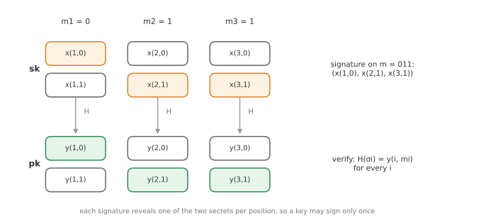
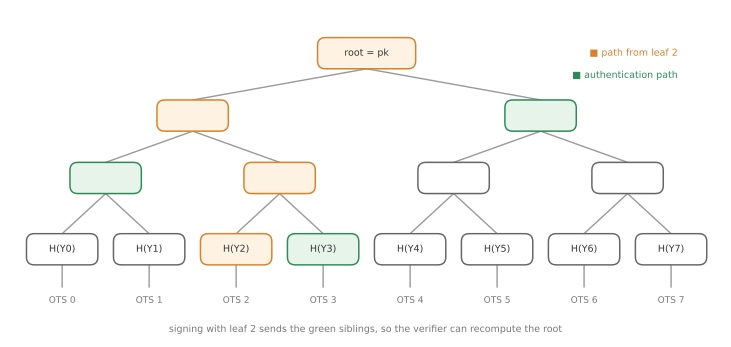
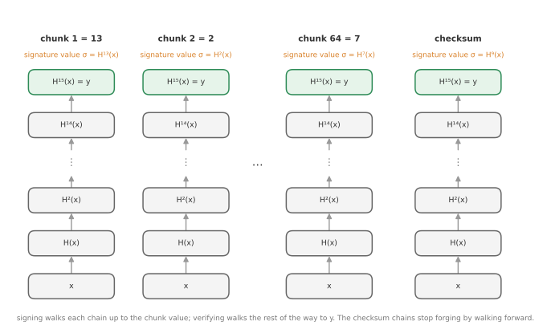

# Module 13: Post-Quantum and Hash-Based Signatures

*What breaks when large quantum computers arrive, and how can we build signatures that rely on nothing but a hash function?*

Every public-key scheme in Modules 9 to 12 relies on factoring or discrete logarithms. A large enough quantum computer would solve both efficiently. **Post-quantum cryptography** replaces these with problems that are believed to be hard even for quantum computers. This module explains the threat, gives an overview of the post-quantum families, and then studies the most conservative of them in detail: **hash-based signatures**, from Lamport's one-time signatures to SPHINCS+.

---

## 1. The quantum threat

Two quantum algorithms matter for cryptography.

**Shor's algorithm (1994)** solves integer factorisation and discrete logarithms in **polynomial time**, a superpolynomial speed-up over the best classical algorithms. It breaks:

- RSA (encryption and signatures);
- DSA, ECDSA, EdDSA;
- Diffie-Hellman and elliptic-curve Diffie-Hellman key exchange;
- in short, essentially all public-key cryptography deployed today.

**Grover's algorithm (1996)** searches an unstructured space of size $N$ in about $\sqrt{N}$ steps, a **quadratic** speed-up. It affects:

- exhaustive key search: a $k$-bit key offers only about $k/2$ bits of security;
- preimage search for hash functions;
- password cracking and other brute-force problems.

The impact is very different. Grover is countered by **doubling key and output sizes**: AES-256 and SHA-256 or larger remain fine. Shor cannot be countered by bigger keys; the underlying problems must be **replaced**.

> **Post-quantum vs quantum cryptography.** *Post-quantum* cryptography consists of ordinary (classical) algorithms, running on ordinary computers, designed to resist attackers who have quantum computers. *Quantum* cryptography, such as quantum key distribution (QKD), uses quantum physics itself to protect communication and needs special hardware. The cryptography deployed today is classical, and this module is about post-quantum cryptography.

A practical concern is **"harvest now, decrypt later"**: an attacker can record encrypted traffic today and decrypt it once a quantum computer exists. This is why the migration of key exchange to post-quantum algorithms is already under way, even though large quantum computers do not exist yet.

### A brief timeline

- **Late 1970s:** McEliece's code-based encryption (1978, as old as RSA) and Lamport's hash-based signatures (1979). Many post-quantum ideas predate the quantum threat.
- **1985:** Deutsch describes a universal quantum computer.
- **1989:** Merkle's tree-based signature scheme.
- **1994 / 1996:** Shor's and Grover's algorithms.
- **1990s to 2000s:** multivariate schemes (HFE, UOV, Rainbow), isogeny-based ideas, lattice-based cryptography.
- **2003:** Daniel J. Bernstein coins the term "post-quantum cryptography".
- **2015 to 2016:** NIST announces its post-quantum standardisation project; ETSI starts a quantum-safe working group.
- **2024:** NIST publishes the first standards: **FIPS 203** (ML-KEM, from Kyber), **FIPS 204** (ML-DSA, from Dilithium) and **FIPS 205** (SLH-DSA, from SPHINCS+).

### The post-quantum families

| Family | Hard problem | Main use |
|---|---|---|
| **Lattice-based** | SIS, LWE, SVP and related problems | KEMs, signatures, encryption (ML-KEM, ML-DSA) |
| **Code-based** | decoding random linear codes | encryption, KEMs (Classic McEliece, HQC) |
| **Multivariate** | solving systems of quadratic polynomial equations (MQ) | mainly signatures (UOV; Rainbow was broken in 2022) |
| **Isogeny-based** | finding isogenies between supersingular elliptic curves | KEMs, signatures (SIKE was broken in 2022; others remain) |
| **Hash-based** | only a secure hash function | signatures only |

The common practical challenge is **size and speed**: post-quantum schemes tend to have much larger public keys, ciphertexts or signatures than elliptic-curve schemes. (A 256-bit ECC key versus a Classic McEliece public key of hundreds of kilobytes is an extreme example.)

**Hash-based signatures** are attractive because their security rests only on properties of a hash function, which are very well understood. If SHA-2 or SHA-3 is secure, they are secure; there is no number theory or lattice assumption that might later fall.

---

## 2. Lamport one-time signatures

Lamport's scheme (1979) signs a message of $\ell$ bits using only a hash function $H$.

**Key generation.** For each bit position $i = 1, \dots, \ell$ and each bit value $b \in \{0, 1\}$, choose a random $n$-bit string $x_{i,b}$ and hash it:

$$
y_{i,b} = H(x_{i,b}).
$$

$$
sk = \begin{pmatrix} x_{1,0} & x_{2,0} & \cdots & x_{\ell,0} \\ x_{1,1} & x_{2,1} & \cdots & x_{\ell,1} \end{pmatrix},
\qquad
pk = \begin{pmatrix} y_{1,0} & y_{2,0} & \cdots & y_{\ell,0} \\ y_{1,1} & y_{2,1} & \cdots & y_{\ell,1} \end{pmatrix}.
$$

**Signing** $m = m_1 m_2 \dots m_\ell$: for each bit, reveal the secret value selected by that bit:

$$
\sigma = (x_{1,m_1},\; x_{2,m_2},\; \dots,\; x_{\ell,m_\ell}).
$$

**Verifying:** accept iff $H(\sigma_i) = y_{i,m_i}$ for all $i$.

**Example.** To sign $m = 011$, reveal $x_{1,0}$, $x_{2,1}$ and $x_{3,1}$. The verifier hashes each and compares with $y_{1,0}$, $y_{2,1}$ and $y_{3,1}$.

**Why it is secure.** Forging a signature on a different message $m^* \neq m$ requires, at some position where the bits differ, a preimage of a public value $y_{i,b}$ whose secret was never revealed. That is a preimage attack on $H$.

**Why only once.** Each signature reveals half of the secret key. After signing $m = 011$ and $m' = 101$, the attacker knows both $x_{1,0}$ and $x_{1,1}$, and both $x_{2,0}$ and $x_{2,1}$, so it can sign $001$ and $111$ as well. Every additional signature makes forgery easier. Each key pair may sign **exactly one** message.

### One-time security

The matching security notion is **EUF-1-CMA** (also called existential unforgeability under a single-message attack): like EUF-CMA (Module 11), but the adversary may make only **one** signing query, on a message $m'$ of its choice, and must then forge a signature on any $m^* \neq m'$.

**Theorem.** If $H$ is a one-way function, Lamport's scheme is one-time EUF-CMA secure.

To sign messages longer than $\ell$ bits, sign $H(M)$ instead; this additionally requires $H$ to be collision-resistant.

**Cost.** With $\ell = n = 256$, the secret and public keys are each $2 \times 256 \times 256$ bits = 16 KB, and a signature is 8 KB, for a single use.

---

## 3. Merkle signatures: many messages, one public key

A one-time signature is useless on its own: you would need to distribute a new public key for every message. Merkle's idea (1989) is to generate many one-time key pairs and authenticate all of them with a single hash value using a **binary hash tree**.

**Key generation.**

1. Generate $2^h$ one-time key pairs $(X_i, Y_i)$, for $i = 0, \dots, 2^h - 1$.
2. The leaves of the tree are $H(Y_i)$.
3. Each internal node is the hash of its two children: $\mathrm{node} = H(\mathrm{left} \Vert \mathrm{right})$.
4. The **root** of the tree is the public key. The secret key is the collection of $X_i$, plus a counter $i$.

**Signing** the $i$-th message $M$:

$$
\sigma = \big(i,\; \sigma_{\mathrm{OTS}} = \mathrm{Sign}_{\mathrm{OTS}}(X_i, M),\; Y_i,\; \mathrm{Auth}_i\big),
$$

where the **authentication path** $\mathrm{Auth}_i$ consists of the $h$ sibling nodes on the path from leaf $i$ up to the root. Then increase the counter.

**Verifying:**

1. Check the one-time signature $\sigma_{\mathrm{OTS}}$ on $M$ using $Y_i$.
2. Hash $Y_i$ to get the leaf, then combine it with the sibling nodes in $\mathrm{Auth}_i$, level by level, to recompute a root.
3. Accept iff the recomputed root equals the public key.

The two checks have different jobs. Step 1 shows that $M$ was signed with the one-time key $Y_i$. Step 2 shows that $Y_i$ really belongs to the signer: someone who invented their own one-time key pair could pass step 1, but would not be able to produce sibling values that hash up to the genuine root.

**Security.** If the one-time signature scheme is one-time secure and $H$ is collision-resistant, the Merkle signature scheme is EUF-CMA secure. Any forgery either breaks a one-time signature, or produces a different path to the same root, which contains a hash collision somewhere.

**Statefulness.** The signer must keep track of which leaves have been used, and **never reuse one**. This makes the scheme **stateful**, which is a serious operational constraint: restoring a backup, cloning a virtual machine or signing from several threads could all reuse a leaf and break security.

---

## 4. Winternitz one-time signatures (WOTS)

Lamport signatures are large because each message **bit** costs one hash value in the signature. **Winternitz** signatures sign several bits at a time using **hash chains**, trading signature size for computation.

With **Winternitz parameter $w = 16$**, a 256-bit message (or message hash) is split into 64 chunks of 4 bits, $b_1, \dots, b_{64}$, each with a value between 0 and 15.

- **KeyGen:** choose 64 random secret values $x_1, \dots, x_{64}$. The public key is obtained by hashing each one 15 times: $y_j = H^{15}(x_j)$.
- **Sign:** for each chunk, hash the secret value as many times as the chunk's value: $\sigma_j = H^{b_j}(x_j)$. (A chunk `1101` = 13 gives $\sigma_j = H^{13}(x_j)$.)
- **Verify:** complete each chain: check $H^{15 - b_j}(\sigma_j) = y_j$ for all $j$.

### The trivial attack and the checksum

Hash chains can be walked **forward** by anyone. From a signature value $\sigma_j = H^{b_j}(x_j)$, anyone can compute $H(\sigma_j) = H^{b_j+1}(x_j)$, which is a valid signature value for chunk value $b_j + 1$. So from one signature, an attacker can forge signatures on any message whose chunks are all **greater than or equal to** the signed ones.

The fix is to also sign a **checksum**

$$
C = \sum_{j=1}^{64} (15 - b_j),
$$

using a few extra chains (three more 4-bit chunks suffice here). If the attacker increases any $b_j$, the checksum **decreases**, and signing the smaller checksum would require walking a checksum chain **backward**, which means inverting $H$. The checksum chains effectively run in the opposite direction to the message chains, so no change can move every chain forward.

**Result:** 67 hash values of 32 bytes, about 2.1 KB per signature, compared with 8 KB for Lamport, at the cost of up to 15 hash evaluations per chain. Larger $w$ gives smaller signatures and more computation.

---

## 5. Standardised hash-based signatures

### Stateful: XMSS and LMS

- **XMSS** (eXtended Merkle Signature Scheme, RFC 8391): Merkle trees with WOTS+ at the leaves, plus protection against **multi-target attacks** (random bitmasks so that an attacker cannot attack many hash computations at once), a tight security proof, and keys and signatures of a few kilobytes.
- **LMS** (Leighton-Micali Signatures, RFC 8554): a similar design with a simpler structure.

NIST endorses both in SP 800-208. Being **stateful**, they are ideal where signatures are naturally counted and issued from one place, such as **firmware updates and code signing**, but unsuitable for backups, multithreaded signing or virtual machines that may be cloned or rolled back.

### Stateless: SPHINCS+

**SPHINCS+** removes the state. The idea: make the tree so **enormous** that if each signature uses a leaf chosen **pseudorandomly** (from the message and a secret), the probability of ever reusing one is negligible.

A single tree of that size would be impossible to compute, so SPHINCS+ uses a **hypertree**: a tree of trees, where each tree's leaves sign the roots of the trees below it, and only the trees along the path to the chosen leaf are computed during signing. At the very bottom, a **few-time signature** scheme (FORS) signs the message, so that the rare event of reusing a bottom key is not fatal.

- Security relies only on the hash function: solid and conservative.
- The price is **large signatures**: about 8 KB for the small, slower variant at 128-bit security (and around 17 KB for the fast variant).
- Standardised by NIST in **FIPS 205 (SLH-DSA)** in August 2024.

| | Lamport | WOTS | XMSS / LMS | SPHINCS+ (SLH-DSA) |
|---|---|---|---|---|
| Messages per key | 1 | 1 | $2^h$ | practically unlimited |
| State | n/a | n/a | **stateful** | stateless |
| Signature size (128-bit level) | ~8 KB | ~2 KB | a few KB | ~8 to 17 KB |
| Assumption | one-way $H$ | one-way $H$ | hash properties | hash properties |

---

## Key takeaways

- **Shor** breaks RSA, DSA, ECDSA and Diffie-Hellman outright; **Grover** only halves symmetric security, so doubling key sizes is enough.
- **Post-quantum** cryptography is classical cryptography designed to resist quantum attackers; it is not the same as quantum cryptography.
- The main families are lattice-, code-, multivariate-, isogeny- and hash-based; NIST standardised ML-KEM, ML-DSA and SLH-DSA in 2024.
- **Lamport** signatures reveal one secret per message bit and are secure for **one** message if $H$ is one-way.
- **Merkle trees** authenticate $2^h$ one-time keys under a single root; the signer must track used leaves (**stateful**).
- **WOTS** uses hash chains plus a **checksum** to shrink signatures.
- **XMSS/LMS** are standardised stateful schemes; **SPHINCS+** (SLH-DSA) is stateless, with large signatures.

**Previous:** [Module 12: Commitments, Zero Knowledge and Discrete-Log Signatures](12-commitments-zero-knowledge.md) · **Next:** [Module 14: Authenticated Key Exchange](14-authenticated-key-exchange.md)
