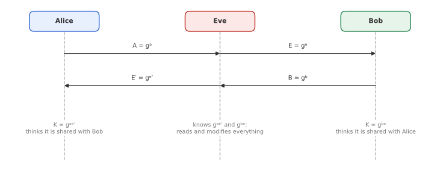
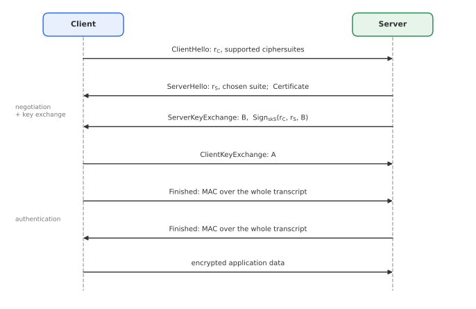

# Module 14: Authenticated Key Exchange

*How do two parties who have never met agree on a secret key over a network controlled by an attacker, and know who they agreed it with?*

This module puts the building blocks together into real protocols. Starting from plain Diffie-Hellman, we add authentication step by step, and at each step look at what goes wrong: man-in-the-middle attacks, identity misbinding, missing identity protection. This sequence of fixes leads to the **SIGMA** family of protocols, which underlies IKE (IPsec) and the TLS 1.3 handshake. We finish with a comparison of TLS 1.2 and TLS 1.3.

---

## 1. Why key exchange, and what is forward secrecy?

The goal of **authenticated key exchange (AKE)** is that two parties end up with a shared session key, and each knows **who** the other party is.

One option is a KEM (Module 10) with the receiver's long-term key pair: Alice encapsulates a session key under Bob's public key. The problem is **forward secrecy**.

> **Forward secrecy:** compromise of a party's **long-term** key must not compromise **past** session keys.

If Bob's long-term decryption key leaks, an attacker who recorded old traffic can decapsulate every past session key that was encapsulated under it. With **ephemeral** Diffie-Hellman, each session uses fresh secret exponents that are deleted after the session key is derived. Recorded traffic stays safe even if long-term keys are stolen later. (A KEM with freshly generated, ephemeral key pairs gives forward secrecy too, which is how post-quantum KEMs are used in TLS.)

---

## 2. Diffie-Hellman and the man in the middle

Alice and Bob agree on a cyclic group $G$ of prime order $q$ with generator $g$.

| Alice | | Bob |
|---|---|---|
| choose random $a$, compute $A = g^a$ | $\xrightarrow{\;A\;}$ | |
| | $\xleftarrow{\;B\;}$ | choose random $b$, compute $B = g^b$ |
| $K = \mathrm{KDF}(B^a)$ | | $K = \mathrm{KDF}(A^b)$ |

Both compute $\mathrm{KDF}(g^{ab})$. A passive eavesdropper sees $g^a$ and $g^b$ and would need to solve CDH (Module 9). Since $a$, $b$ and $g^{ab}$ are deleted after the session, this gives forward secrecy.

### Man-in-the-middle attack

Plain Diffie-Hellman authenticates **nobody**. An active attacker Eve sitting between Alice and Bob:

- runs one Diffie-Hellman exchange with Alice, pretending to be Bob, and gets $K_{AE}$;
- runs another with Bob, pretending to be Alice, and gets $K_{EB}$;
- then decrypts everything Alice sends, reads or modifies it, re-encrypts it for Bob, and vice versa.

Alice and Bob each believe they share a key with the other, but both share a key with Eve. The root cause is the lack of **entity authentication**.

---

## 3. Station-to-Station: adding signatures

Assume each party has a **long-term signing key pair**, and that public keys are authenticated, for example by certificates from a certificate authority (CA). Alice knows $pk_B$ really belongs to Bob because a CA she trusts has certified it, and vice versa. (Stolen private keys are out of scope.)

The basic **Station-to-Station (STS)** idea: each party signs the Diffie-Hellman values.

| Alice | | Bob |
|---|---|---|
| $a$, $A = g^a$ | $\xrightarrow{\;A\;}$ | |
| | $\xleftarrow{\;B,\ \sigma_B\;}$ | $b$, $B = g^b$, $\sigma_B = \mathrm{Sign}_{sk_B}(B, A)$ |
| verify $\sigma_B$; $\sigma_A = \mathrm{Sign}_{sk_A}(A, B)$ | $\xrightarrow{\;\sigma_A\;}$ | verify $\sigma_A$ |
| $K = \mathrm{KDF}(B^a)$ | | $K = \mathrm{KDF}(A^b)$ |

Eve can no longer substitute her own Diffie-Hellman values, because she cannot sign them as Alice or Bob. This gives (claimed) mutual authentication. But the protocol is still vulnerable.

### Identity misbinding

In an **identity misbinding** attack (also called an unknown key-share attack), Alice and Bob end up with the same key, but **disagree about who they are talking to**. Eve cannot read the traffic, but she can cause messages to be attributed to the wrong person.

**Variant 1: Eve re-signs Bob's message.**

1. Alice sends $A$. Eve forwards it to Bob.
2. Bob replies with $B$ and $\sigma_B = \mathrm{Sign}_{sk_B}(B, A)$. Eve replaces $\sigma_B$ with her own $\sigma_E = \mathrm{Sign}_{sk_E}(B, A)$ and presents herself to Alice as the responder.
3. Alice verifies $\sigma_E$ under Eve's (genuine, certified) public key and replies with $\sigma_A = \mathrm{Sign}_{sk_A}(A, B)$, believing she is talking to **Eve**.
4. Eve forwards $\sigma_A$ to Bob, who verifies it and believes he is talking to **Alice**.

Alice and Bob now share $K = \mathrm{KDF}(g^{ab})$, which Eve does not know. But Alice thinks her peer is Eve, and Bob thinks his peer is Alice.

**Variant 2: Eve re-signs Alice's message.** Symmetrically, Eve forwards Bob's message unchanged but replaces Alice's signature with her own. Alice correctly believes she is talking to Bob, but **Bob believes he is talking to Eve**.

Why does this matter if Eve cannot decrypt? In variant 2, anything Alice sends to Bob is credited to Eve. If Alice is submitting a solution to a competition, or a bank deposit, Bob assigns it to Eve. The authentication guarantee, "my session key is shared with the party I think it is", has failed.

The root cause: the signatures say *which Diffie-Hellman values* a party used, but not *with whom* it intended to run the protocol.

---

## 4. Fix 1: sign the peer's identity (ISO/IEC 9798-3)

The direct fix is to include the **intended peer's identity** in each signature:

| Alice | | Bob |
|---|---|---|
| $a$, $A = g^a$ | $\xrightarrow{\;\text{Alice},\ A\;}$ | |
| | $\xleftarrow{\;\text{Bob},\ B,\ \sigma_B\;}$ | $\sigma_B = \mathrm{Sign}_{sk_B}(A, B, \text{Alice})$ |
| $\sigma_A = \mathrm{Sign}_{sk_A}(B, A, \text{Bob})$ | $\xrightarrow{\;\sigma_A\;}$ | |

Now Eve's re-signing fails: Alice's signature names Bob, so Bob would see that Alice did not intend to talk to Eve, and vice versa. This is the signature-based Diffie-Hellman protocol of **ISO/IEC 9798-3**.

**Remaining problems:**

- **No identity protection.** To include the peer's identity, each party must announce its own identity in the clear, and must reveal it *before* knowing who it is really talking to. Any eavesdropper learns who is communicating with whom.
- **No deniability.** Each party's signature explicitly names the other, so it is transferable proof that Alice talked to Bob.

---

## 5. Fix 2: encrypt the signatures (full STS)

The full Station-to-Station protocol (Diffie, van Oorschot and Wiener, 1992) uses the freshly derived key $K$ to **encrypt** the signatures, and drops the identities from inside them:

| Alice | | Bob |
|---|---|---|
| $a$, $A = g^a$ | $\xrightarrow{\;A\;}$ | |
| | $\xleftarrow{\;B,\ \mathrm{Enc}_K(\sigma_B)\;}$ | $K = \mathrm{KDF}(A^b)$, $\sigma_B = \mathrm{Sign}_{sk_B}(B, A)$ |
| $K = \mathrm{KDF}(B^a)$, $\sigma_A = \mathrm{Sign}_{sk_A}(A, B)$ | $\xrightarrow{\;\mathrm{Enc}_K(\sigma_A)\;}$ | |

Certificates can also be sent inside the encryption. This hides identities from passive eavesdroppers, and successful decryption shows the peer knows $K$.

But it is still not ideal:

- Encrypting a signature is a roundabout way to prove knowledge of $K$; encryption is not designed to provide that kind of binding.
- If Eve manages to register **Alice's public key as her own** with a CA (a "certificate under someone else's key"), she can again mount an identity misbinding attack. That is arguably the CA's fault (it should require proof of possession of the private key), but a robust protocol should not depend on it.

---

## 6. SIGMA: SIGn-and-MAc

**SIGMA** (Krawczyk, 2003) separates the two jobs cleanly:

- **Sign** the Diffie-Hellman values, to prove that this party participated in *this* exchange. The signature does **not** include the peer's identity, which preserves deniability.
- **MAC your own identity** under a key derived from $g^{ab}$, to bind your identity to the session key. Only someone who knows the session key can produce this MAC, so Eve cannot substitute her identity.

From the shared secret, the KDF derives a MAC key $K_M$, an encryption key $K_E$ and the session key. The basic (unencrypted) version:

| Alice | | Bob |
|---|---|---|
| $a$, $A = g^a$ | $\xrightarrow{\;A\;}$ | |
| | $\xleftarrow{\;B,\ \text{Bob},\ \mathrm{Sign}_{sk_B}(A, B),\ \mathrm{MAC}_{K_M}(\text{Bob})\;}$ | $b$, $B = g^b$ |
| | $\xrightarrow{\;\text{Alice},\ \mathrm{Sign}_{sk_A}(B, A),\ \mathrm{MAC}_{K_M}(\text{Alice})\;}$ | |

Both parties verify the signature *and* the MAC before accepting.

### SIGMA-I: protecting the initiator's identity

In **SIGMA-I**, the identity, signature and MAC are sent **encrypted** under $K_E$:

| Alice (initiator) | | Bob (responder) |
|---|---|---|
| $a$, $A = g^a$ | $\xrightarrow{\;A\;}$ | |
| | $\xleftarrow{\;B,\ \mathrm{Enc}_{K_E}\big(\text{Bob},\ \mathrm{Sign}_{sk_B}(A, B),\ \mathrm{MAC}_{K_M}(\text{Bob})\big)\;}$ | |
| | $\xrightarrow{\;\mathrm{Enc}_{K_E}\big(\text{Alice},\ \mathrm{Sign}_{sk_A}(B, A),\ \mathrm{MAC}_{K_M}(\text{Alice})\big)\;}$ | |

Alice verifies Bob's identity **before** revealing her own. Her identity is protected even against an **active** attacker, while Bob's is protected against passive ones. This is the structure of the **TLS 1.3** handshake, where the client is the initiator.

### SIGMA-R: protecting the responder's identity

**SIGMA-R** is the mirror image: the initiator reveals its identity first, and the responder verifies it before revealing its own. This needs one extra message.

### Separate keys per direction

In practice, each direction uses its **own** MAC and encryption keys ($K_M, K_E$ for one direction and $K_M', K_E'$ for the other). Otherwise the two directions are symmetric, and an attacker could **reflect** a party's own message back to it as if it came from the peer.

### SIGMA in IKE

**IKE**, the key exchange protocol of IPsec, uses SIGMA. In IKEv1 main mode:

| Alice | | Bob |
|---|---|---|
| $a$, $A = g^a$ | $\xrightarrow{\;A\;}$ | $b$, $B = g^b$ |
| $K_{A,B} = B^a$; $K_M, K_E = \mathrm{KDF}(K_{A,B})$ | $\xleftarrow{\;B\;}$ | |
| $t_A = \mathrm{MAC}_{K_M}(\text{Alice})$, $\sigma_A = \mathrm{Sign}_{sk_A}(B, A, t_A)$ | $\xrightarrow{\;\mathrm{Enc}_{K_E}(\text{Alice},\ \sigma_A)\;}$ | $K_{B,A} = A^b$; $K'_M, K'_E = \mathrm{KDF}(K_{B,A})$ |
| | $\xleftarrow{\;\mathrm{Enc}_{K'_E}(\text{Bob},\ \sigma_B)\;}$ | $t_B = \mathrm{MAC}_{K'_M}(\text{Bob})$, $\sigma_B = \mathrm{Sign}_{sk_B}(A, B, t_B)$ |

Here the MAC tag is placed **inside** the signature rather than sent next to it. IKE also has an "aggressive mode" without identity protection, and IKEv2 makes small changes (for example, the Diffie-Hellman values are not inside the MAC, only the identity).

SIGMA protocols are provably secure, fast, use few rounds and simple parameters, and offer identity protection, which is why they were adopted by both IKE and TLS 1.3.

---

## 7. TLS 1.2 with ephemeral Diffie-Hellman

TLS secures HTTPS and much more. Its history: SSL 2.0 (1995, Netscape, insecure), SSL 3.0 (1996, insecure), TLS 1.0 replaced SSL in 1999, then TLS 1.1 (2006, now deprecated), TLS 1.2 (2008, still acceptable with the right configuration) and TLS 1.3 (2018).

A TLS 1.2 handshake with ephemeral Diffie-Hellman (**TLS-DHE**) has three phases.

**1. Ciphersuite negotiation.** The client sends `ClientHello` with a random nonce $r_C$ and its list of supported ciphersuites (which key exchange, signature, cipher and hash algorithms it can use). The server answers with `ServerHello`, its nonce $r_S$, and the chosen suite.

**2. Key exchange.** The server sends its certificate and a `ServerKeyExchange` message with its Diffie-Hellman value $B$, **signed** with its long-term key (over $r_C$, $r_S$ and $B$). The client verifies this before sending its own value $A$ in `ClientKeyExchange`. Both derive a master secret from $g^{ab}$, $r_C$ and $r_S$ with a KDF, and from it the traffic keys.

**3. Authentication (Finished).** Each side sends a `Finished` message: a MAC, under a key derived from the master secret, over the **entire handshake transcript**, with a label distinguishing client from server. Because the whole transcript is MACed, an attacker who altered any earlier message (including identities) is detected, which prevents identity misbinding.

### Problems with TLS 1.2

- **No identity protection.** Certificates are sent **in the clear**, so any eavesdropper sees which server (and, with client certificates, which client) is involved. On the positive side, the client does not need to know the server's identity in advance.
- **Ciphersuite and version are not signed.** The server's signature covers the Diffie-Hellman value but not the negotiated suite or protocol version. An active attacker can tamper with the negotiation and force both sides down to weak "export-grade" parameters (the **Logjam** and **FREAK** attacks). The Finished MACs would detect this, but if the downgraded parameters are weak enough to break in real time, the attacker can forge the Finished messages too. This is a **downgrade attack**.
- **Extremely complex:** hundreds of ciphersuites and options, much legacy cryptography never removed (RSA key transport without forward secrecy, CBC with MAC-then-encrypt, RC4, export ciphers).
- **Many round trips** (two before application data), adding latency.
- Old operating systems that never supported TLS 1.1 or 1.2 remain exposed to old attacks.

### A decade of attacks on SSL and TLS up to 1.2

| Year | Attack | What it exploited |
|---|---|---|
| 1998, 2006 | Bleichenbacher | RSA PKCS #1 v1.5 padding errors as a decryption oracle; signature forgery |
| 2011 | BEAST | predictable CBC IVs in SSL 3.0 / TLS 1.0 |
| 2012-13 | CRIME / BREACH | data compression leaking secrets through ciphertext length |
| 2013 | Lucky Thirteen | timing side-channel in CBC MAC-then-encrypt |
| 2014 | POODLE | SSL 3.0 CBC padding |
| 2014 | BERserk | PKCS #1 v1.5 signature forgery via loose parsing |
| 2014 | Heartbleed | buffer over-read in OpenSSL leaking memory, including keys |
| 2015-16 | FREAK / Logjam | downgrade to export-grade RSA / Diffie-Hellman |
| 2016 | DROWN | using a server's SSLv2 support to break TLS |
| 2016 | Sweet32 | birthday attacks on 64-bit block ciphers (3DES) in CBC mode |
| 2018, 2023 | ROBOT, Everlasting ROBOT | Bleichenbacher's 1998 attack still working on many TLS implementations |

Many of these map directly onto earlier modules: padding oracles (Module 4), birthday bounds on small blocks (Modules 1 and 2), RSA's structure (Modules 9 and 11).

---

## 8. TLS 1.3

TLS 1.3 (RFC 8446, 2018) is a redesign, informed by these attacks and by the SIGMA analysis.

| | TLS 1.2 | TLS 1.3 |
|---|---|---|
| Round trips before data | 2 | **1** (0 with resumption) |
| Key exchange | RSA transport or (EC)DHE | **only (EC)DHE** (forward secrecy always) |
| Encryption | many, incl. CBC, RC4 | **only AEAD**: AES-GCM, ChaCha20-Poly1305, AES-CCM |
| Certificates | sent in clear | **encrypted** |
| Signature covers | DH value and nonces | **entire handshake transcript** (`CertificateVerify`) |
| Downgrade protection | weak | transcript signature plus a downgrade sentinel in the server random |
| Key derivation | custom PRF | **HKDF** (Module 7) |
| Structure | ad hoc | SIGMA-I |

The client sends its Diffie-Hellman share (`key_share`) already in the `ClientHello`, guessing which group the server will accept. The server responds with its share, and **everything after `ServerHello` is encrypted**: extensions, certificate, `CertificateVerify` (a signature over the whole transcript so far) and `Finished`. The client authenticates the server before sending anything that identifies itself.

Optional **0-RTT** mode lets a returning client send data with its very first message, using a pre-shared key from an earlier session, at the cost of losing forward secrecy and replay protection for that early data.

TLS 1.3 is also where the post-quantum migration is happening first: browsers and large providers now use **hybrid** key exchange, combining X25519 with ML-KEM (Module 10), so that the session key stays secure if either one holds.

---

## Key takeaways

- **Ephemeral Diffie-Hellman** gives **forward secrecy**, but unauthenticated DH falls to a **man in the middle**.
- **STS** signs the DH values, but signatures without the peer's identity allow **identity misbinding**.
- **ISO/IEC 9798-3** adds the peer's identity to the signature, at the cost of identity protection and deniability.
- **SIGMA** signs the DH values and **MACs its own identity** with a session-derived key; SIGMA-I protects the initiator's identity and is the basis of **TLS 1.3**; IKE also uses SIGMA.
- **TLS 1.2** sends certificates in the clear, does not sign the negotiated parameters, and accumulated a long list of attacks.
- **TLS 1.3**: one round trip, only ephemeral DH and AEAD, encrypted certificates, a transcript signature, HKDF, and now hybrid post-quantum key exchange.

**Previous:** [Module 13: Post-Quantum and Hash-Based Signatures](13-hash-based-signatures.md) · **Next:** [Module 15: Key Management](15-key-management.md)
