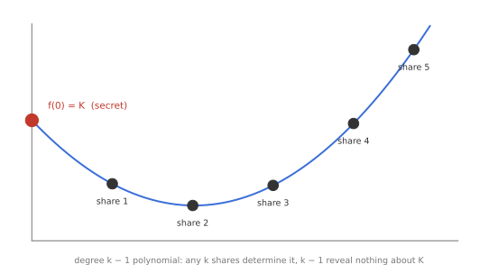
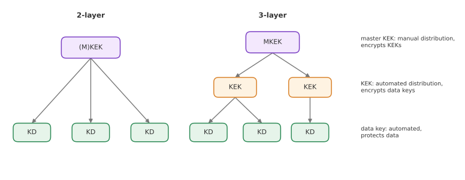
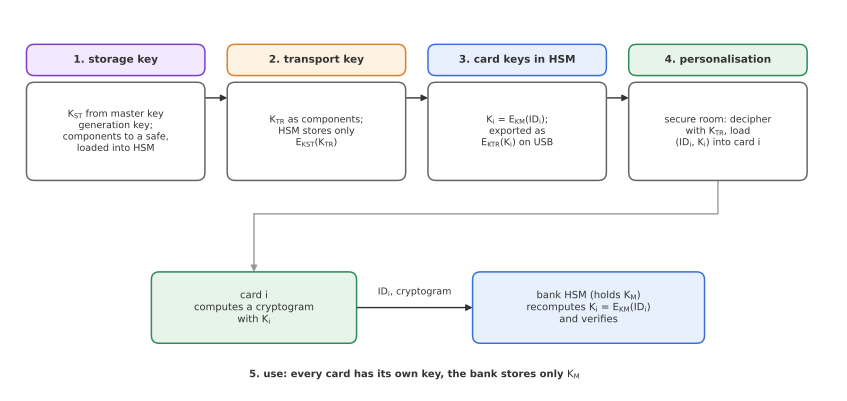

# Module 15: Key Management

*Every scheme in this series assumes the key is secret and random. Who makes sure that is actually true?*

All the security proofs in Modules 1 to 14 start from the same assumptions: in symmetric cryptography, the key has enough entropy and is unknown to the adversary; in public-key cryptography, the same holds for the private key, and the public key is authentic. **Key management** is everything needed to make those assumptions hold in practice, over the whole life of a key. It is less about clever mathematics and more about **policies, procedures and hardware**. This module follows the international standard for financial key management, ISO 11568, and finishes with a complete walkthrough of how a bank issues and uses keys for payment smart cards.

---

## 1. The dimensions of the problem

It helps to classify key management problems by how many parties are involved.

**One-dimensional: encrypting for yourself.** Disk encryption (Module 7) is the typical example: the same person encrypts and later decrypts. There is no key to transport, only a key to derive and protect: PRNG → salt → PBKDF2 → XTS-AES.

**Two-dimensional: two parties establishing a key.** Diffie-Hellman key exchange, authenticated with signatures as in ISO/IEC 9798-3 or SIGMA (Module 14). Ephemeral keys (as in TLS) and continuous re-keying ("ratcheting", as in the Signal messenger) limit the damage of a compromise. But this does not make the problem go away: it **reduces** it to authenticating public keys, which in turn relies on trust on first use (TOFU), chains of certificates, or simply meeting people and comparing fingerprints.

**Multi-dimensional: a third party manages keys for many others.** A bank issuing keys to millions of cards, a company managing keys for thousands of servers, a payment network connecting many banks. This is where key management becomes a discipline of its own.

---

## 2. The key lifecycle

Key management covers the whole **life cycle** of a key, from its generation to its end. The main **key events** are:

| Stage | Events |
|---|---|
| Beginning | generation, distribution, loading |
| Active life | use, storage, back-up |
| Change | replacement |
| End | destruction, deletion, archival, termination |

Each event is an opportunity for the key to leak, be misused, or be lost. The difference between *deletion* and *destruction* is worth noting: deleting a key from one location is not the same as destroying every copy of it, including back-ups.

---

## 3. The principles of ISO 11568

ISO 11568 is the international standard for key management in retail financial services (card payments, ATMs). It is built on twelve principles, which are a useful checklist far beyond banking. In paraphrase:

| | Principle |
|---|---|
| **a** | Keys exist only in the **forms permitted** by the standard. |
| **b** | **No single person** can access or determine any plaintext secret or private key. |
| **c** | Systems **prevent the disclosure** of any secret or private key that has been or will be used to protect data. |
| **d** | Keys are generated so that their values are **unpredictable**, with no value more likely than another. |
| **e** | Systems **detect attempted disclosure** of a key, and attempted use for an unintended purpose. |
| **f** | Systems **prevent or detect use for other than the intended purpose**, and any unauthorised modification, substitution, deletion or insertion of a key. |
| **g** | A key is **replaced** within the time it would take to determine it. |
| **h** | A key is **replaced** within the time it would take to mount a successful dictionary attack on data encrypted under it. |
| **i** | A key **stops being used** as soon as its compromise is known or suspected. |
| **j** | Compromise of a key shared by one group of parties does **not compromise keys of other groups**. |
| **k** | A compromised key gives **no information about its replacement**. |
| **l** | A key is **only loaded** into a device when it can reasonably be assured that the device is secure and unmodified. |

Principle (b) deserves emphasis. It rules out the simplest designs, such as one administrator who generates a key and types it into a server, and leads directly to split knowledge and dual control (Section 5). Principle (j) is the reason every card gets its own key rather than sharing one. Principle (k) rules out deriving the next key from the current one in a reversible way.

The rest of this module walks through the lifecycle, noting which principles each step serves.

---

## 4. Key forms and generation

### Permitted forms (principle a)

A key may exist only in one of three forms:

- **Plaintext key:** only inside secure hardware, during generation and storage.
- **Key components:** separate parts held by different people, used for **manual** distribution and loading. No single component reveals anything about the key.
- **Enciphered key:** encrypted under another key. This is used for automated distribution, $E_{K_{TR}}(K)$ under a **transport key** $K_{TR}$, and for storage, $E_{K_{ST}}(K)$ under a **storage key** $K_{ST}$.

### Generation (principle d)

- **True random number generators (TRNGs)** use a physical noise source in hardware.
- **Deterministic random bit generators (DRBGs)**, or pseudorandom number generators, expand a random seed using cryptographic components (for example AES in CTR mode, or HMAC).
- NIST SP 800-90 (parts A, B and C) specifies DRBGs, entropy sources, and how to combine them.

Generating **plaintext master keys** is the most sensitive step of all. The master key generation key is used to produce transport keys, storage keys and data keys, so generation happens in secure hardware, in a secure room, following written procedures, with reliable staff, and with several people present.

---

## 5. Distribution and loading (principles b, c, d, l)

### Split knowledge

Keys are often generated in **key parts**. Custodian A holds $K_A$, custodian B holds $K_B$, and the key is their XOR:

$$
K = K_A \oplus K_B.
$$

Each part on its own is a uniformly random string that reveals nothing about $K$. Loading the key requires both custodians to be present (**dual control**), so no single person ever knows it.

### Secret sharing

**Shamir's secret sharing** generalises this to a **$(k, n)$ threshold**: any $k$ of $n$ custodians can reconstruct the key, but $k - 1$ learn nothing.

1. Choose a random polynomial $f$ of degree $k - 1$ over a finite field, with the secret as its constant term: $f(0) = K$.
2. Give custodian $i$ the point $(x_i, f(x_i))$.
3. Any $k$ points determine the polynomial uniquely (by Lagrange interpolation), and hence $K = f(0)$. With $k - 1$ points, every value of $K$ is still equally possible.

This adds resilience: if one custodian leaves the company or loses their share, the key is not lost. More advanced setups (hierarchical thresholds, different weights per custodian) are also possible.

**Distribution** happens through a secure transport medium (key components carried by different people, or keys enciphered under transport keys). **Loading** happens inside a secure module such as an HSM, never on an ordinary computer (principle l).

---

## 6. Key hierarchy (principle a)

Rather than distributing every key manually, keys are organised in a **hierarchy**, where keys higher up encrypt keys lower down.

- **Master key encryption key (MKEK):** at the top; distributed **manually** (as components); encrypts the key encryption keys.
- **Key encryption keys (KEKs):** distributed automatically, encrypted under the MKEK; encrypt the data keys.
- **Data keys (KD):** distributed automatically, encrypted under a KEK; these are the keys that actually protect data. Depending on the application they may be user keys, session keys, encryption keys, MAC keys and so on.

A **two-layer** hierarchy has a (master) KEK directly above the data keys; a **three-layer** hierarchy inserts a level of KEKs in between.

The benefit is that keys can be **replaced frequently and efficiently**. Replacing a data key only means sending a new one encrypted under the KEK; only the top-level key ever needs the slow, manual procedure. The VeraCrypt header key from Module 7 is a tiny instance of the same idea. (NIST SP 800-57 Part 1 lists many more key types than these three.)

---

## 7. Key replacement (principles f, g, h)

How long should a key be used? Its **cryptoperiod** depends on:

- the strength of the algorithm and key length;
- how frequently the key is used (more use means more data for an attacker);
- the sensitivity of the data and how long it must remain protected.

With a key hierarchy, replacement is easy. NIST suggests a cryptoperiod of **one to two years** for most keys, with notable exceptions: about **one year** for a symmetric master key, and **one use** for an ephemeral key.

Selected cryptoperiods from NIST SP 800-57 Part 1 (Rev. 5):

| Key type | Originator-usage period | Recipient-usage period |
|---|---|---|
| Private signature key | 1 to 3 years | n/a |
| Public signature-verification key | several years (depends on key size) | |
| Symmetric authentication key | ≤ 2 years | ≤ originator period + 3 years |
| Symmetric data encryption key | ≤ 2 years | ≤ originator period + 3 years |
| Symmetric key-wrapping key | ≤ 2 years | ≤ originator period + 3 years |
| Symmetric master key / key-derivation key | about 1 year | n/a |
| Private / public key-transport key | ≤ 2 years / 1 to 2 years | |
| Private ephemeral key-agreement key | one key-agreement transaction | |

The recipient-usage period can be longer than the originator's: data encrypted near the end of a key's active life may still need to be decrypted years later.

---

## 8. Key storage: hardware security modules (principles a, c, e, f, i)

A **hardware security module (HSM)** is a dedicated, tamper-resistant device for cryptographic keys and operations.

**Core functions:**

- secure onboard key generation and storage;
- performing cryptographic operations with keys that never leave the device in plaintext;
- optionally, application-specific functions such as generating PIN data or magnetic stripe data.

**Security on three levels:**

- **Physical security:** tamper resistance and tamper response.
- **Functional security:** it only performs approved operations, in approved ways.
- **Implementation security:** no leakage of keys, through side channels or otherwise.

HSMs are certified under **FIPS 140-3**, programmed through a standard API such as **PKCS #11**, and cost in the order of ten thousand euros each.

An HSM can be configured to **erase its keys** on any sign of tampering. That can backfire: in regions prone to earthquakes, or anywhere the device might be bumped or vibrated, a natural event could be interpreted as an attack and wipe the keys. This is one reason why careful **back-up** procedures are part of key management too.

---

## 9. Case study: keys for payment smart cards

This walkthrough shows how a bank might issue individual keys to payment cards and later verify transactions, and how each step follows the principles above.

**Step 1: storage keys.** In a secure room, a **storage key** $K_{ST}$ is generated from the master key generation key, which is kept offline. It is split into components (shown as $K_{ST_1}$, $K_{ST_2}$), which go to a safe for back-up, and it is loaded into the HSM.

**Step 2: transport keys.** A **transport key** $K_{TR}$ is generated, again as components ($K_{TR_1}$, $K_{TR_2}$). It is loaded into the card personalisation computer, and also into the HSM. HSM memory is limited, so the HSM does not keep every key internally: it stores $E_{K_{ST}}(K_{TR})$, the transport key encrypted under its storage key, in an external database. Only the HSM can unwrap it.

**Step 3: individual card keys.** Inside the HSM, which holds a master key $K_M$, each card gets its own key, **derived from its identifier**:

$$
K_i = E_{K_M}(\mathrm{ID}_i).
$$

The card keys are immediately encrypted under the transport key, $E_{K_{TR}}(K_i)$, and exported to a USB stick. The plaintext card keys never leave the HSM.

**Step 4: personalisation.** In the secure room, the personalisation computer, holding $K_{TR}$, deciphers the keys from the USB stick and loads $(\mathrm{ID}_i, K_i)$ into each smart card.

**Step 5: use.** During a transaction, the card computes a cryptogram (for example a MAC over the transaction data) with $K_i$ and sends it, with its $\mathrm{ID}_i$, through the payment terminal to the bank. The bank's HSM, which holds $K_M$, **recomputes** $K_i = E_{K_M}(\mathrm{ID}_i)$ on the fly and verifies the cryptogram.

**Why this design works:**

- The bank never stores millions of card keys: one master key and the card IDs are enough (**key diversification**).
- Every card has a **different key**, so extracting the key from one card (for example by a side-channel attack) does not compromise any other card (principle j).
- No person ever sees a plaintext key: keys exist only as components, inside HSMs, or enciphered (principles a, b, c).
- Keys are only loaded into the HSM and the cards in a controlled environment (principle l).

---

## Key takeaways

- Every security proof assumes secret, random keys and authentic public keys; **key management** is what makes those assumptions true.
- Problems range from one-dimensional (disk encryption) to two-dimensional (key exchange, which reduces to public-key authentication) to multi-dimensional (third-party key management).
- A key's **lifecycle** runs from generation through use, storage, back-up and replacement to destruction or archival.
- **ISO 11568** gives twelve principles: permitted key forms, no single person knows a key, unpredictability, purpose binding, timely replacement, compartmentalisation and secure loading.
- **Split knowledge** ($K = K_A \oplus K_B$) and **Shamir secret sharing** enforce dual control; **key hierarchies** make replacement cheap.
- **HSMs** store and use keys in tamper-resistant hardware (FIPS 140-3, PKCS #11).
- Smart card systems use **key diversification**, $K_i = E_{K_M}(\mathrm{ID}_i)$, so each card has its own key without the bank storing them all.

**Previous:** [Module 14: Authenticated Key Exchange](14-authenticated-key-exchange.md) · [Back to the overview](../README.md)
